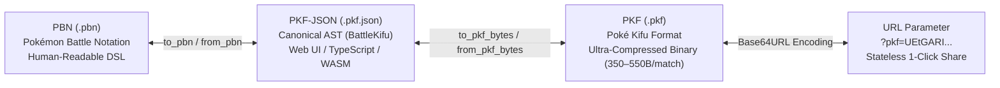

This document serves as the official reference for the **PKF (Poké Kifu Format) / PBN (Pokémon Battle Notation)** battle record specification, specifically designed for Pokémon Champions (official Double Battle / VGC format), covering match logging, video OCR extraction, AI evaluation analysis, and web sharing.

## 1. Why a New Battle Notation Format?

### Limitations of Existing Formats (Showdown Replays / Battle Video Logs)

1. **Unique Metagame Rules of Pokémon Champions**:
   - EV scales are capped at **0 to 32 points per stat (max 66 in total)** rather than the standard 0–252.
   - Information asymmetry between Open Team Sheet (OTS) and Closed Team Sheet (CTS).
   - Fusion of historical Mega Evolution mechanics with modern Double Battle rules.
2. **Integration of Video OCR Extraction and AI Solvers**:
   No standard format previously allowed combining video capture OCR provenance (`@t=...ms`, confidence `@conf=...`, review flags `@review`) with MCTS/GTO engine evaluation scores and move classifications (`@best`, `@quality`) in a single, cohesive notation.

## 2. 3-Tier Isomorphic Architecture

The PKF format system is architected across three representations that map losslessly to each other through a single Abstract Syntax Tree (AST: `BattleKifu`):



| Format                                | Extension / MIME                            | Primary Purpose                                              | Characteristics                                                                          |
| :------------------------------------ | :------------------------------------------ | :----------------------------------------------------------- | :--------------------------------------------------------------------------------------- |
| **PBN**<br/>(Pokémon Battle Notation) | `.pbn`<br/>`text/x-pbn`                     | Human inspection, manual editing, Git versioning, OCR output | Line-oriented DSL. Intuitive to read and edit directly in any text editor.               |
| **PKF**<br/>(Poké Kifu Format)        | `.pkf`<br/>`application/vnd.poketistix.pkf` | Storage, database indexing, URL parameter sharing            | Dictionary-indexed with 1-byte opcodes. An entire battle fits in **~350–550 bytes**.     |
| **PKF-JSON**                          | `.pkf.json`<br/>`application/json`          | Web frontend, APIs, WASM interop                             | Canonical interoperability AST shared between Rust (`kifu.rs`) and TypeScript (`tsify`). |

---

## 3. PBN (Pokémon Battle Notation, `.pbn`) Practical Guide

PBN prioritizes human readability and direct editing. Empty lines and lines starting with `#` are treated as comments and ignored by parsers.

### 3.1 PBN File Structure Overview

```text
[PBN "1.0"]                      <- Header: Metadata (Regulation, Sheet format, Result, etc.)
[Regulation "M-C"]
[Sheet "CTS"]
[Result "WIN"]

@p1 0 raichu @ raichunite-y ...   <- P1 Party (Full details: EVs, actual stats, 4 moves)
...
@select 5, 1, 2, 4               <- 4 Selected Pokémon (Indices for leads and backline)

@p2 0 golisopod                  <- P2 Preview Team (Species only in CTS, full details in OTS)
...

@lead @t=106000ms                <- Turn 0: Leads sent out and entry abilities
  switch p2b farigiraf 100%
  ...

@turn 1 @t=115000ms              <- Turn 1: Turn header and active conditions
  @field Rain 1/5                <- Active field conditions at turn start (elapsed/max)
  @state
  p1:
    | active: salamence 172/172, incineroar 234/234
    | bench: rillaboom 209/209, volcarona 224/224
  p2:
    | active: garchomp 100%, farigiraf 100%
    | bench: 2 alive
  @cmd p1a: protect | p1b: snarl <- Player command inputs
  move p1a protect ...           <- Turn action and outcome events
  ...
```

---

### 3.2 Walkthrough of a Real Battle Match

Below is an annotated PBN match record extracted from live battle video OCR:

```text
[PBN "1.0"]
[Regulation "M-C"]
[Sheet "CTS"]
[Result "WIN"]

# ==============================================================================
# P1 (Player Team) Registered Information (6 Pokémon)
# Format: @p1 <idx> <slug> @ <item> | <ability> | <Nature + EVs> | <Stats> | <Moves>
# ==============================================================================
@p1 0 raichu @ raichunite-y | lightning-rod | Timid H24 B10 S32+ | 183,99,95,110,100,213 | zap-cannon, focus-blast, encore, protect
@p1 1 incineroar @ sitrus-berry | intimidate | Impish H32 A3 B10+ D11 S10 | 234,141,143,90,132,100 | flare-blitz, snarl, parting-shot, fake-out
@p1 2 rillaboom @ miracle-seed | grassy-surge | Adamant H17 A26+ S23 | 209,216,110,72,90,151 | grassy-glide, wood-hammer, high-horsepower, fake-out
@p1 3 basculegion-male @ choice-scarf | adaptability | Jolly H1 A32 B1 S32+ | 197,196,87,90,95,178 | last-respects, wave-crash, flip-turn, icy-wind
@p1 4 volcarona @ grassy-seed | flame-body | Modest H32 B29 C5+ | 224,72,143,181,125,120 | overheat, struggle-bug, rage-powder, tailwind
@p1 5 salamence @ salamencite | intimidate | Mild H1 C32+ D1 S32 | 172,155,90,213,102,184 | hyper-voice, double-edge, tailwind, protect

# 4 Selected Pokémon: Leads (Salamence #5, Incineroar #1), Backline (Rillaboom #2, Volcarona #4)
@select 5, 1, 2, 4

# ==============================================================================
# P2 (Opponent) Team Preview (6 Pokémon)
# In CTS (Closed Team Sheet), species only. In OTS, items and moves may be included.
# ==============================================================================
@p2 0 golisopod
@p2 1 rillaboom
@p2 2 farigiraf
@p2 3 pelipper
@p2 4 garchomp
@p2 5 archaludon

# ==============================================================================
# Lead (Turn 0): Leads sent out and entry abilities
# ==============================================================================
@lead @t=106000ms
  switch p2b farigiraf 100%
  switch p2a garchomp 100%
  switch p1a salamence 172/172
  switch p1b incineroar 234/234
  ability p1a intimidate {
    p2a: atk -1
    p2b: atk -1
  }
  ability p1b intimidate {
    p2a: atk -1
    p2b: atk -1
  }

# ==============================================================================
# Turn 1: Opponent Mega Evolves + Helping Hand + Protect + Snarl
# ==============================================================================
@turn 1 @t=120000ms
  @cmd p1a: protect | p1b: snarl
  mega p2a garchomp-mega-z
  move p2b helping-hand -> p2a
  move p1a protect
  move p2a dragon-pulse -> p1a { protected }
  move p1b snarl {
    p2a: 100% -> 88%, spa -1
    p2b: 100% -> 80%, spa -1
  }

# ==============================================================================
# Turn 2: Switch + Grassy Surge + Trick Room
# ==============================================================================
@turn 2 @t=174000ms
  @cmd p1a: switch rillaboom | p1b: snarl
  switch p2a archaludon 100%
  switch p1a rillaboom 209/209 {
    ability p1a grassy-surge
    terrain Grassy
  }
  move p1b snarl {
    p2a: 100% -> 92% {
      ability p2a stamina
      boost p2a def +1
      boost p2a spa -1
    }
    p2b: 80% -> 62%, spa -1
  }
  move p2b trick-room {
    field trick-room on
  }

# ==============================================================================
# Turn 3: Grassy Terrain and Trick Room Active (Turn 2 of 5)
# ==============================================================================
@turn 3 @t=391000ms
  @field
    | entire: Grassy 2/5, Trick Room 2/5
    | p1: Tailwind 2/4
  @state
  p1:
    | active: rillaboom 209/209, incineroar 234/234
    | bench: volcarona 224/224, salamence fnt
  p2:
    | active: archaludon 92% (def +1, spa -1), farigiraf 62% [par] (spa -1)
    | bench: golisopod 100%, ? 100%
  @cmd p1a: wood-hammer -> p2b | p1b: flare-blitz -> p2b
  move p2b electro-shot {
    p1b: 234/234 -> 126/234
  }
```

---

## 4. Formal EBNF Grammar (v1.0 Revised)

PBN is a line-oriented domain-specific language (DSL). Braces `{ ... }` encapsulate causality scopes such as target outcomes, chained reactions, and switch-in ability effects.

```ebnf
/* ========================================================================== */
/* Complete PBN Document Structure (v1.0 Revised)                             */
/* ========================================================================== */
<pbn_document>        ::= { <blank_or_comment> }*
                          { <header_line> { <blank_or_comment> }* }*
                          { <team_directive> { <blank_or_comment> }* }*
                          [ <select_directive> { <blank_or_comment> }* ]
                          { <preview_directive> { <blank_or_comment> }* }*
                          [ <lead_section> { <blank_or_comment> }* ]
                          { <turn_section> { <blank_or_comment> }* }*

<blank_or_comment>    ::= [<indent>] [ "#" <any_text> ] <newline>

/* -------------------------------------------------------------------------- */
/* 1. Headers and Metadata ([Tag "Value"])                                    */
/* -------------------------------------------------------------------------- */
<header_line>         ::= [<indent>] "[" <tag_name> <ws> '"' <tag_value> '"' "]" [<ws>] <newline>
<tag_name>            ::= "PBN" | "Regulation" | "Sheet" | "Result" | "Rating" | <ident>
<tag_value>           ::= <any_char_except_quote>*

/* -------------------------------------------------------------------------- */
/* 2. Team Directives (@p1, @p2, @select)                                     */
/* -------------------------------------------------------------------------- */
<team_directive>      ::= [<indent>] "@p1" <ws> <idx> <ws> <species> [ <ws> "@" <ws> <item_id> ]
                          <ws> "|" <ws> <ability_id>
                          <ws> "|" <ws> <nature_spread>
                          <ws> "|" <ws> <stats_six>
                          <ws> "|" <ws> <moves_list> [<ws>] <newline>

<select_directive>    ::= [<indent>] "@select" <ws> <idx> { [<ws>] "," [<ws>] <idx> }* [<ws>] <newline>

<preview_directive>   ::= [<indent>] "@p2" <ws> <idx> <ws> <species>
                          [ <ws> "@" <ws> <item_id> ]
                          [ <ws> "|" <ws> <ability_id> ]
                          [ <ws> "|" <ws> <nature_spread> ]
                          [ <ws> "|" <ws> <stats_six> ]
                          [ <ws> "|" <ws> <moves_list> ] [<ws>] <newline>

<nature_spread>       ::= <nature_name> { <ws> <ev_alloc> }*
<ev_alloc>            ::= ("H" | "A" | "B" | "C" | "D" | "S") <number> [ "+" | "-" ]
<stats_six>           ::= <stat_val> "," [<ws>] <stat_val> "," [<ws>] <stat_val> "," [<ws>] <stat_val> "," [<ws>] <stat_val> "," [<ws>] <stat_val>
<stat_val>            ::= <number> | "?"
<moves_list>          ::= <move_id> { [<ws>] "," [<ws>] <move_id> }*

/* -------------------------------------------------------------------------- */
/* 3. Turn Sections (@lead, @turn)                                            */
/* -------------------------------------------------------------------------- */
<lead_section>        ::= [<indent>] "@lead" { <ws> <turn_meta> }* [<ws>] <newline>
                          { <lead_event> | <blank_or_comment> }*

<turn_section>        ::= [<indent>] "@turn" <ws> <number> { <ws> <turn_meta> }* [<ws>] <newline>
                          { <blank_or_comment> }*
                          [ <field_state_section> { <blank_or_comment> }* ]
                          [ <team_state_section> { <blank_or_comment> }* ]
                          [ <cmd_line> { <blank_or_comment> }* ]
                          [ <p2cmd_line> { <blank_or_comment> }* ]
                          { <turn_event> | <blank_or_comment> }*

<turn_meta>           ::= "@t=" <number> "ms"
                        | "@eval=" [ "+" | "-" ] <float> "%"
                        | "@best=" '"' <any_char_except_quote>* '"'
                        | "@quality=" ("Best" | "Good" | "Inaccuracy" | "Blunder")
                        | <meta_token>

<field_state_section> ::= [<indent>] "@field" [ <ws> <field_scope_line> ] [<ws>] <newline>
                          { [<indent>] "|" <ws> <field_scope_line> [<ws>] <newline> }*

<field_scope_line>    ::= [ "|" <ws> ] <field_scope_item> { [<ws>] "|" <ws> <field_scope_item> }*

<field_scope_item>    ::= <field_scope> ":" <ws> <cond_item_list>
<field_scope>         ::= "entire" | "p1" | "p2"

<cond_item_list>      ::= <field_cond_item> { [<ws>] "," <ws> <field_cond_item> }*
<field_cond_item>     ::= <condition_name> <ws> <number> "/" <number>

<team_state_section>  ::= [<ws_opt>] "@state" [<ws_opt>] <newline>
                          { [<ws_opt>] <side_header> [<ws_opt>] <newline>
                            { [<ws_opt>] "|" [<ws_opt>] <side_item> [<ws_opt>] <newline> }* }*

<side_header>         ::= "p1:" | "p2:"
<side_item>           ::= "active:" <ws> <active_poke_list>
                        | "bench:" <ws> <bench_poke_list>
<active_poke_list>    ::= <poke_entry> { [<ws_opt>] "," [<ws_opt>] <poke_entry> }*
<bench_poke_list>     ::= <bench_entry> { [<ws_opt>] "," [<ws_opt>] <bench_entry> }*

<poke_entry>          ::= [ <slot> <ws> ] <species> <ws> <hp_val> [ <ws> "[" <status_id> "]" ] [ <ws> "(" <stat_boost_list> ")" ]
<stat_boost_list>     ::= <stat_boost> { [<ws>] "," [<ws>] <stat_boost> }*

<bench_entry>         ::= ( <species> | "?" ) [ <ws> ( <hp_val> | "fnt" ) ] [ <ws> "[" <status_id> "]" ]
                        | <number> <ws> ("alive" | "remaining")

<cmd_line>            ::= [<indent>] "@cmd" <ws> "p1a:" <ws> <slot_action> <ws> "|" <ws> "p1b:" <ws> <slot_action> [<ws>] <newline>
<p2cmd_line>          ::= [<indent>] "@p2cmd" <ws> "p2a:" <ws> <slot_action> <ws> "|" <ws> "p2b:" <ws> <slot_action> [<ws>] <newline>
<slot_action>         ::= "switch" <ws> <species>
                        | <move_id> [ <ws> "->" <ws> <slot> ] [ <ws> "+mega" ]
                        | "pass"
                        | "?"

/* -------------------------------------------------------------------------- */
/* 4. Event Blocks and Outcomes                                               */
/* -------------------------------------------------------------------------- */
<lead_event>          ::= <switch_block>
                        | <ability_block>
                        | <item_block>
                        | <field_event>

<turn_event>          ::= <mega_line>
                        | <move_block>
                        | <cant_line>
                        | <switch_block>
                        | <ability_block>
                        | <item_block>
                        | <field_event>
                        | <damage_line>
                        | <heal_line>
                        | <boost_line>
                        | <status_line>
                        | <faint_line>

/* Mega Evolution and Inability to Move */
<mega_line>           ::= [<indent>] "mega" <ws> <slot> <ws> <species> [ <ws> <item_id> ] { <ws> <meta_token> }* [<ws>] <newline>
<cant_line>           ::= [<indent>] "cant" <ws> <slot> <ws> <reason_id> [ <ws> <move_id> ] { <ws> <meta_token> }* [<ws>] <newline>

/* Move Execution Block (Single-line `{ protected }` & multi-line block supported) */
<move_block>          ::= <move_header> [ <ws> <move_scope> ] [<ws>] <newline>
<move_header>         ::= [<indent>] "move" <ws> <slot> <ws> <move_id> [ <ws> "->" <ws> <slot> ] { <ws> <meta_token> }*
<move_scope>          ::= "{" [<ws>] <inline_move_outcome> [<ws>] "}"
                        | "{" [<ws>] <newline> { <move_child_event> | <blank_or_comment> }* [<indent>] "}"

<inline_move_outcome> ::= "protected" | "missed" | "failed" | "immune"
<move_child_event>    ::= <target_block>
                        | [<indent>] <inline_move_outcome> { <ws> <meta_token> }* [<ws>] <newline>
                        | <field_event>
                        | <switch_block>
                        | <ability_block>
                        | <item_block>
                        | <damage_line>
                        | <heal_line>
                        | <boost_line>
                        | <faint_line>

/* Target Outcomes and Reactions */
<target_block>        ::= [<indent>] ("target" <ws> | "->" <ws>) <slot> ":" <ws> <outcome_list> { <ws> <meta_token> }* [ <ws> <reaction_scope> ] [<ws>] <newline>
<outcome_list>        ::= <outcome_item> { [<ws>] "," [<ws>] <outcome_item> }*
<outcome_item>        ::= <damage_hp>
                        | <stat_boost>
                        | <status_change>
                        | "protected" | "missed" | "immune" | "crit" | "super-effective" | "resisted" | "fainted"

<damage_hp>           ::= <hp_val> <ws> "->" <ws> <hp_val>
<stat_boost>          ::= <stat_name> <ws> <stat_delta>
<stat_delta>          ::= ("+" | "-") ("1" | "2" | "3" | "4" | "5" | "6" | "12")
<status_change>       ::= ("+" | "-") <status_id>

/* Causality Reaction Scopes */
<reaction_scope>      ::= "{" [<ws>] <newline> { <reaction_event> | <blank_or_comment> }* [<indent>] "}"
<reaction_event>      ::= <target_block>
                        | <ability_block>
                        | <item_block>
                        | <boost_line>
                        | <status_line>
                        | <damage_line>
                        | <heal_line>
                        | <switch_block>
                        | <field_event>
                        | <faint_line>

/* Switch Block */
<switch_block>        ::= <switch_header> [ <ws> <reaction_scope> ] [<ws>] <newline>
<switch_header>       ::= [<indent>] "switch" <ws> <slot> <ws> <species> <ws> <hp_val> { <ws> <meta_token> }*

/* Ability & Item Blocks */
<ability_block>       ::= <ability_header> [ <ws> <reaction_scope> ] [<ws>] <newline>
<ability_header>      ::= [<indent>] "ability" <ws> <slot> <ws> <ability_id> { <ws> <meta_token> }*

<item_block>          ::= <item_header> [ <ws> <reaction_scope> ] [<ws>] <newline>
<item_header>         ::= [<indent>] "item" <ws> <slot> <ws> <item_id> [ <ws> ("consumed" | "activated" | "revealed") ] { <ws> <meta_token> }*

/* Primitive Event Lines */
<boost_line>          ::= [<indent>] "boost" <ws> <slot> <ws> <stat_name> <ws> <stat_delta> { <ws> <meta_token> }* [<ws>] <newline>
<status_line>         ::= [<indent>] "status" <ws> <slot> <ws> <status_change> [ <ws> <cause_id> ] { <ws> <meta_token> }* [<ws>] <newline>
<damage_line>         ::= [<indent>] "damage" <ws> <slot> <ws> <damage_hp> [ <ws> <cause_id> ] { <ws> <meta_token> }* [<ws>] <newline>
<heal_line>           ::= [<indent>] "heal" <ws> <slot> <ws> <damage_hp> [ <ws> <cause_id> ] { <ws> <meta_token> }* [<ws>] <newline>
<faint_line>          ::= [<indent>] "faint" <ws> <slot> { <ws> <meta_token> }* [<ws>] <newline>

/* Field Events */
<field_event>         ::= <weather_line> | <terrain_line> | <field_change_line> | <side_line>
<weather_line>        ::= [<indent>] "weather" <ws> ("Rain" | "HarshSunlight" | "Sandstorm" | "Snow" | "None") { <ws> <meta_token> }* [<ws>] <newline>
<terrain_line>        ::= [<indent>] "terrain" <ws> ("Electric" | "Grassy" | "Misty" | "Psychic" | "None") { <ws> <meta_token> }* [<ws>] <newline>
<field_change_line>   ::= [<indent>] "field" <ws> <field_condition> <ws> ("on" | "off") { <ws> <meta_token> }* [<ws>] <newline>
<side_line>           ::= [<indent>] "side" <ws> ("p1" | "p2") <ws> <side_condition> <ws> ("on" | "off" | <number>) { <ws> <meta_token> }* [<ws>] <newline>

/* -------------------------------------------------------------------------- */
/* 5. Terminals and Tokens                                                    */
/* -------------------------------------------------------------------------- */
<slot>                ::= "p1a" | "p1b" | "p2a" | "p2b"
<stat_name>           ::= "atk" | "def" | "spa" | "spd" | "spe" | "accuracy" | "evasion"
<status_id>           ::= "brn" | "par" | "slp" | "frz" | "psn" | "tox" | "confusion" | "taunt" | "encore" | <ident>
<hp_val>              ::= <percentage> | <exact_hp> | "0" | "fnt" | "?"
<percentage>          ::= <number> "%"
<exact_hp>            ::= <number> "/" <number>

<condition_name>      ::= "Trick Room" | "Gravity" | "Rain" | "HarshSunlight" | "Sandstorm" | "Snow"
                        | "Electric" | "Grassy" | "Misty" | "Psychic"
                        | "Tailwind" | "Reflect" | "Light Screen" | "Aurora Veil" | "Safeguard" | "Mist"
                        | "Stealth Rock" | "Spikes" | "Toxic Spikes" | "Sticky Web"
                        | <ident>
<field_condition>     ::= "trick-room" | "gravity" | "fairy-lock" | "wonder-room" | "magic-room" | <ident>
<side_condition>      ::= "tailwind" | "reflect" | "light-screen" | "aurora-veil" | "safeguard" | "mist"
                        | "stealth-rock" | "spikes" | "toxic-spikes" | "sticky-web" | "wide-guard" | "quick-guard" | <ident>

<idx>                 ::= "0" | "1" | "2" | "3" | "4" | "5"
<species>             ::= <slug>
<item_id>             ::= <slug>
<ability_id>          ::= <slug>
<move_id>             ::= <slug>
<reason_id>           ::= <slug>
<cause_id>            ::= "[" <slug> "]" | <slug>
<nature_name>         ::= "Hardy" | "Lonely" | "Brave" | "Adamant" | "Naughty"
                        | "Bold" | "Docile" | "Relaxed" | "Impish" | "Lax"
                        | "Timid" | "Hasty" | "Serious" | "Jolly" | "Naive"
                        | "Modest" | "Mild" | "Quiet" | "Bashful" | "Rash"
                        | "Calm" | "Gentle" | "Sassy" | "Careful" | "Quirky"

<slug>                ::= [a-z0-9]+ { "-" [a-z0-9]+ }*
<ident>               ::= [A-Za-z0-9_-]+
<number>              ::= [0-9]+
<float>               ::= [0-9]+ [ "." [0-9]+ ]

<indent>              ::= [ \t]*
<ws>                  ::= [ \t]+
<newline>             ::= [ "\r" ] "\n"

<meta_token>          ::= "@review"
                        | "@t=" <number> "ms"
                        | "@conf=" <float> [ "%" ]
                        | "@note=" '"' <any_char_except_quote>* '"'
                        | "[" <any_char_except_bracket>* "]"
```

---

## 5. PBN Syntax Reference

### 5.1 Directives (Turn Control, Commands, Field States)

Directives are lines starting with `@`.

| Directive               | Example                                                                                                                                                                                                                         | Description                                                                                                                                                                                                     |
| :---------------------- | :------------------------------------------------------------------------------------------------------------------------------------------------------------------------------------------------------------------------------ | :-------------------------------------------------------------------------------------------------------------------------------------------------------------------------------------------------------------- |
| `@turn`                 | `@turn 1 @t=12000ms [@eval=64.2%] [@best="..."] [@quality=Best]`                                                                                                                                                                | Marks turn start. May include timestamp, solver evaluation, and quality tags.                                                                                                                                   |
| `@field`                | `@field entire: Grassy 2/5, Trick Room 2/5 \| p1: Tailwind 2/4`                                                                                                                                                                 | **Active field states at turn start**. Grouped by scope (`entire`, `p1`, `p2`) with comma-separated effects, separated by `\|`. Multi-line continuation using leading `\|` (Pattern Style B) is also supported. |
| `@state`                | `@state\n  p1:\n    \| active: rillaboom 209/209, incineroar 234/234\n    \| bench: volcarona 224/224, salamence fnt\n  p2:\n    \| active: archaludon 92% (def +1), farigiraf 62% [par]\n    \| bench: golisopod 100%, ? 100%` | **Team Pokémon state at turn start**. Uses side blocks (`p1:` / `p2:`) with indented `\| active: <active Pokémon>` and `\| bench: <bench Pokémon>` lines.                                                       |
| `@cmd`                  | `@cmd p1a: hyper-voice +mega \| p1b: flare-blitz`                                                                                                                                                                               | Player's chosen inputs (moves, targets, switches, Mega Evolution).                                                                                                                                              |
| `@p2cmd`                | `@p2cmd p2a: protect \| p2b: trick-room`                                                                                                                                                                                        | Opponent's actions (optional, recorded when known via replays or logs).                                                                                                                                         |
| `@note="..."` / `[...]` | `@note="Careful against opponent Fake Out while Mega Evolving"`                                                                                                                                                                 | Human review and analysis notes (decoupled from `{ ... }`).                                                                                                                                                     |

> [!NOTE]
> **Slot Identifiers (`PokemonIdent`)**:
>
> - `p1a`: Player 1 left slot
> - `p1b`: Player 1 right slot
> - `p2a`: Opponent (Player 2) left slot (center-right on screen)
> - `p2b`: Opponent (Player 2) right slot (far right on screen)

---

### 5.2 Command Vocabulary

| Command          | Syntax                                                 | Role                                                                                                                            |
| :--------------- | :----------------------------------------------------- | :------------------------------------------------------------------------------------------------------------------------------ |
| `switch`         | `switch <slot> <slug> <hp>`                            | Sent out or switched in. P1 uses exact HP (`curr/max`), P2 uses percentage (`XX%`). Can have `{ ... }` scope for entry effects. |
| `move`           | `move <attacker> <move_id> [-> <target>]`              | Move declaration. Target omitted for spread moves. Can have `{ ... }` scope for target outcomes.                                |
| `target:` / `->` | `target <slot>: <damage_hp>, <stat_boost>`             | Target-specific outcome line grouping damage, stat modifications, and status changes.                                           |
| `ability`        | `ability <slot> <ability_id>`                          | Ability activation. Standalone or with `{ ... }` scope for reaction abilities (e.g. Stamina).                                   |
| `item`           | `item <slot> <item_id> [consumed]`                     | Item activation or consumption. Standalone or with `{ ... }` scope.                                                             |
| `boost`          | `boost <slot> <stat> <delta>`                          | Stat stage modification (e.g., `boost p2a def +1`).                                                                             |
| `status`         | `status <slot> <+\|-<status_id>> [<cause>]`            | Status condition inflection or cure (e.g., `status p1a +par`, `status p1b -slp [lum-berry]`).                                   |
| `damage`         | `damage <slot> <damage_hp> [<cause>]`                  | Residual or indirect damage (Weather, Burn, Life Orb, Rocky Helmet, etc.).                                                      |
| `cant`           | `cant <slot> <reason> [<move>]`                        | Inability to move (Paralysis, Sleep, Freeze, Flinch, Taunt, etc.).                                                              |
| `mega`           | `mega <slot> <mega_species>`                           | Mega Evolution declaration.                                                                                                     |
| `terrain`        | `terrain <Electric\|Grassy\|Misty\|Psychic\|None>`     | Terrain activation or expiration.                                                                                               |
| `weather`        | `weather <Rain\|HarshSunlight\|Sandstorm\|Snow\|None>` | Weather activation or expiration.                                                                                               |
| `field`          | `field <trick-room\|gravity\|fairy-lock> <on\|off>`    | Global field condition toggle.                                                                                                  |
| `side`           | `side <p1\|p2> <tailwind\|reflect> <on\|off>`          | Side condition toggle (Tailwind, screens, etc.).                                                                                |
| `heal`           | `heal <target> <damage_hp> [<cause>]`                  | HP recovery (Terrain, Leftovers, Berry, healing moves).                                                                         |
| `faint`          | `faint <target>`                                       | Fainted Pokémon.                                                                                                                |

---

## 6. PKF (Poké Kifu Format, `.pkf`) Binary Specification

`.pkf` is an **ultra-compact little-endian binary format** optimized for database storage and URL query sharing.

### 6.1 File Header (8 bytes)

```
0                   1                   2                   3
0 1 2 3 4 5 6 7 8 9 0 1 2 3 4 5 6 7 8 9 0 1 2 3 4 5 6 7 8 9 0 1
+-+-+-+-+-+-+-+-+-+-+-+-+-+-+-+-+-+-+-+-+-+-+-+-+-+-+-+-+-+-+-+-+
|       'P'     |       'K'     |       'F'     |  Version (1)  |
+-+-+-+-+-+-+-+-+-+-+-+-+-+-+-+-+-+-+-+-+-+-+-+-+-+-+-+-+-+-+-+-+
| Regulation ID |  Flags Bitset |          Turn Count           |
+-+-+-+-+-+-+-+-+-+-+-+-+-+-+-+-+-+-+-+-+-+-+-+-+-+-+-+-+-+-+-+-+
```

- **`Magic (3B)` + `Version (1B)`**: `0x50, 0x4B, 0x46, 0x01` (`"PKF\x01"`)
- **`Regulation ID (1B)`**: `0` = Champions M-A, `1` = M-B, `2` = M-C
- **`Flags Bitset (1B)`**:
  - `Bit 0`: `is_open_team_sheet` (0=CTS, 1=OTS)
  - `Bit 1`: `has_provenance` (Includes video timestamps and OCR confidence)
  - `Bit 2`: `has_annotations` (Includes AI evaluation cache)
  - `Bit 3..4`: `result` (`00`=Unknown, `01`=P1Win, `10`=P2Win, `11`=Draw)
- **`Turn Count (2B, u16-LE)`**: Number of turns in the match

### 6.2 String Table

A typical battle contains at most 30 to 40 unique entity identifiers (species, moves, abilities, items). A unique slug dictionary is stored at the head of the file once, and all subsequent events reference entities via **1-byte (`u8`) indices**.

### 6.3 Bit-Packed Event Opcodes (1 byte + Payload)

Slot identifiers (`PokemonIdent`) require only **2 bits** (`00`=p1a, `01`=p1b, `10`=p2a, `11`=p2b). The upper 4 bits represent the Opcode, and the lower 4 bits pack target slots and flags.

| Opcode (Upper 4b) | Command             | Payload                                                                  | Total Size |
| :---------------- | :------------------ | :----------------------------------------------------------------------- | :--------- |
| `0x1_`            | `SwitchIn`          | `(player:1b, slot:1b)` + `team_idx:u8` + `species_idx:u8` + `ObservedHp` | 4–6 B      |
| `0x2_`            | `MegaEvolve`        | `target:2b` + `mega_species_idx:u8` + `item_idx:u8`                      | 3 B        |
| `0x3_`            | `MoveUsed`          | `attacker:2b` + `has_target:1b` + `target:2b` + `move_idx:u8`            | 2 B        |
| `0x4_`            | `Damage`            | `target:2b` + `flags:u8` + `hp_after` + conditional diff                 | 3–7 B      |
| `0x5_`            | `Heal`              | `target:2b` + `hp_after` + `effect_idx:Option<u8>`                       | 2–4 B      |
| `0x6_`            | `AbilityTriggered`  | `source:2b` + `ability_idx:u8`                                           | 2 B        |
| `0x7_`            | `ItemTriggered`     | `source:2b` + `consumed:1b` + `item_idx:u8`                              | 2 B        |
| `0x8_`            | `StatStageChanged`  | `target:2b` + `(stat:3b, delta+6:4b)`                                    | 2 B        |
| `0x9_`            | `StatusChanged`     | `target:2b` + `status_code:u8`                                           | 2 B        |
| `0xA_`            | `Weather / Terrain` | `kind:2b` + `id:4b`                                                      | 1 B        |
| `0xB_`            | `Field / SideCond`  | `field_id:3b` + `active:1b`                                              | 1 B        |
| `0xC_`            | `Faint`             | `target:2b`                                                              | 1 B        |

> [!TIP]
> **Extreme Compactness**:
> An entire battle (approx. 10 turns, 60–80 events) takes **only 350 to 550 bytes** in binary form. When encoded with Base64URL, it fits into ~470–730 characters, allowing **entire battle records and AI solver analysis to be shared via a single URL query parameter without server persistence** (`https://poketistix.com/en/battle-record?pkf=...`).
