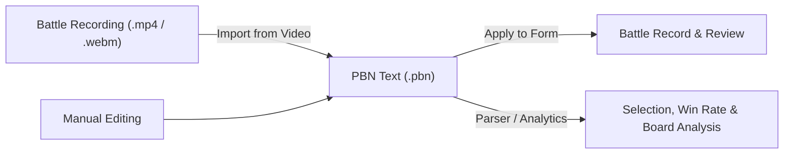

This document is the official reference for **PBN (Pokémon Battle Notation, `.pbn`)**, a human-readable text format designed to record, edit, share, and analyze _Pokémon Champions_ matches.

## 1. What is PBN?

PBN is a line-oriented domain-specific language (DSL) built for direct reading and editing in any text editor.

- **Built for _Pokémon Champions_**:
  - Supports the Champions EV scale of **0–32 per stat (max 66 total)**.
  - Models the information asymmetry between Closed Team Sheets (CTS) and Open Team Sheets (OTS), recording known opponent Pokémon while representing unrevealed bench slots with `?`.
- **Causal Event Scopes (`{ ... }`)**:
  - Groups move outcomes, hit reactions (such as Sitrus Berry heals or triggered abilities), and switch-in abilities/weather/terrain inside curly-brace blocks.
- **Video Analysis Integration**:
  - Preserves video timestamps (`@t=...ms`) on `@lead` and `@turn` headers so battle logs can be cross-checked against recorded gameplay and edited seamlessly.



---

## 2. File Structure Overview

Blank lines and lines starting with `#` are treated as comments. A PBN file consists of the following sections in order:

```pbn
[PBN "1.0"]                         # 1. Headers (format version, regulation, result, etc.)
[Regulation "M-C"]
[Sheet "CTS"]
[Result "WIN"]

@p1 0 gengar @ gengarite | ...      # 2. Player team (6 Pokémon)
...
@select 0, 1, 3, 2                  # 3. Player selection (2 leads, 2 backline)

@p2 0 torkoal                       # 4. Opponent preview team (6 Pokémon)
...

@lead @t=62000ms                    # 5. Lead deployment (Turn 0)
  switch p2b torkoal 100%
  switch p2a trevenant 100%
  switch p1a gengar 165/165
  switch p1b incineroar 202/202 {
    ability p1b intimidate
  }

@turn 1 @t=75000ms                  # 6. Turn sections (one per turn)
  @field Sandstorm 5/5 | Grassy 4/5
  @state
  p1:
    | active:
        p1a: gengar 165/165
        p1b: incineroar 202/202
    | bench: rillaboom 207/207, hippowdon 215/215
  p2:
    | active:
        p2a: trevenant 100%
        p2b: torkoal 100%
    | bench: ? 100%, ? 100%
  @cmd p1a: shadow-ball p2b +mega | p1b: fake-out p2a
  mega p1a gengar-mega
  move p1b fake-out {
    p2a: 100% -> 93%
  }
  ...

  # the battle has ended due to all pokemon fainting
```

---

## 3. Headers & Metadata

Headers appear at the top of the file in `[Tag "Value"]` format.

| Tag          | Required | Example Values                              | Description                                           |
| :----------- | :------- | :------------------------------------------ | :---------------------------------------------------- |
| `PBN`        | Required | `"1.0"`                                     | PBN specification version.                            |
| `Regulation` | Required | `"M-A"`, `"M-B"`, `"M-C"`                   | Official regulation identifier.                       |
| `Sheet`      | Required | `"CTS"` / `"OTS"`                           | Closed Team Sheet (`CTS`) or Open Team Sheet (`OTS`). |
| `Result`     | Required | `"WIN"` / `"LOSS"` / `"DRAW"` / `"UNKNOWN"` | Match outcome from P1's perspective.                  |
| `Rating`     | Optional | `"1845.181"`                                | Post-match rating displayed on the result screen.     |

---

## 4. Team & Selection Directives

### 4.1 Player Team (`@p1`)

Registers each team member (`0`–`5`) with species, item, ability, nature & EVs, Level 50 stats, and four moves separated by `|`.

```pbn
@p1 <idx> <species> [@ <item>] | <ability> | <Nature> [<EVs>] | <H,A,B,C,D,S> | <move1, move2, move3, move4>
```

- **Identifiers (Slugs)**: Species, items, abilities, and moves use lowercase hyphenated slugs (e.g., `sitrus-berry`, `grassy-surge`, `parting-shot`).
- **EVs (Champions 32/66 Scale)**: Stat letters `H`, `A`, `B`, `C`, `D`, `S` followed by `0`–`32`, with `+` or `-` denoting nature boosts/drops (e.g., `Timid H30 C5 D24 S7+`).

### 4.2 Player Selection (`@select`)

Lists the 4 selected `@p1` indices in order: **2 leads (`p1a`, `p1b`), then 2 backline Pokémon**.

```pbn
@select 0, 1, 3, 2
```

### 4.3 Opponent Preview Team (`@p2`)

In CTS matches, only species slugs are listed. In OTS matches (or when details are revealed), `@ item | ability | moves` may be appended.

```pbn
@p2 0 torkoal
@p2 1 snorlax
@p2 2 trevenant
@p2 3 sinistcha
@p2 4 swampert
@p2 5 pelipper
```

---

## 5. Lead & Turn Structure

### 5.1 Slot Identifiers & HP Formats

| Slot          | Meaning                    | HP Representation                                 |
| :------------ | :------------------------- | :------------------------------------------------ |
| `p1a` / `p1b` | Player left / right slot   | Exact HP `current/max` (e.g., `165/165`, `0/165`) |
| `p2a` / `p2b` | Opponent left / right slot | Percentage `0%`–`100%` (e.g., `93%`, `0%`)        |

### 5.2 Lead Section (`@lead`)

Records initial lead switches and entry abilities/weather/terrain before Turn 1 begins.

```pbn
@lead @t=62000ms
  switch p2b torkoal 100%
  switch p2a trevenant 100%
  switch p1a gengar 165/165
  switch p1b incineroar 202/202 {
    ability p1b intimidate
  }
```

### 5.3 Turn Headers & State Snapshots (`@turn`, `@field`, `@state`, `@cmd`)

Each turn begins with active field conditions (`@field`), a board snapshot (`@state`), and player command inputs (`@cmd`).

- **`@field`**: Lists active weather, terrain, and field effects at the start of the turn with **remaining / max turns** separated by `|` (e.g., `Sandstorm 5/5 | Grassy 4/5 | Trick Room 3/5`). Counters count down `5/5` → `4/5` → … → `1/5`. Weather or terrain set by an end-of-turn faint replacement starts at `5/5` (or `8/8` with extending items) on the next turn.
- **`@state`**:
  - `active:` lists each active slot's species, HP, major status (`[brn]`, `[par]`, `[slp]`, `[psn]`, `[tox]`, `[frz]`), and stat stage changes (`(atk -1, spd +1)`).
  - `bench:` lists benched Pokémon. Fainted Pokémon are marked `fnt`, and unrevealed opponent slots are marked `? 100%`.
- **`@cmd`**: Records P1's chosen actions separated by `|`:
  - Move: `<move_id> [<target_slot>] [+mega]` (e.g., `shadow-ball p2b +mega`)
  - Switch: `switch <species>` (e.g., `switch incineroar`)
  - Unknown / Pass: `?` / `pass`

```pbn
@turn 4 @t=320000ms
  @field Sandstorm 4/5 | Grassy 3/5 | Trick Room 2/5
  @state
  p1:
    | active:
        p1a: hippowdon 215/215
        p1b: rillaboom 183/207
    | bench: gengar-mega fnt, incineroar 120/202
  p2:
    | active:
        p2a: trevenant 98%
        p2b: torkoal 90%
    | bench: ? 100%, ? 100%
  @cmd p1a: high-horsepower p2b | p1b: switch incineroar
```

---

## 6. Event Syntax Reference

Turn events are written chronologically, one event per line, with causal reactions nested inside `{ ... }` blocks.

### 6.1 Event Commands

| Command   | Syntax                                        | Description & Examples                                                                                                                        |
| :-------- | :-------------------------------------------- | :-------------------------------------------------------------------------------------------------------------------------------------------- |
| `mega`    | `mega <slot> <species>`                       | Mega Evolution. e.g., `mega p1a gengar-mega`                                                                                                  |
| `move`    | `move <slot> <move_id> [{ ... }]`             | Move execution. Inline outcome (`{ protected }`, `{ missed }`, `{ failed }`, `{ immune }`) or multi-line block for target damage and effects. |
| `switch`  | `switch <slot> <species> <hp> [{ ... }]`      | Switch-in. Entry abilities and weather/terrain changes are nested inside `{ ... }`.                                                           |
| `ability` | `ability <slot> <ability_id>`                 | Ability activation. e.g., `ability p1b intimidate`                                                                                            |
| `item`    | `item <slot> <item_id>`                       | Item activation or consumption. e.g., `item p1a occa-berry`                                                                                   |
| `damage`  | `damage <slot> <before> -> <after> [<cause>]` | Residual, recoil, or chip damage. e.g., `damage p1b 110/202 -> 60/202 [recoil]`, `damage p2b 90% -> 84% [sandstorm]`                          |
| `heal`    | `heal <slot> <before> -> <after> [<cause>]`   | HP recovery. e.g., `heal p1b 84/202 -> 134/202 [sitrus-berry]`, `heal p1a 146/215 -> 159/215 [leftovers]`                                     |
| `boost`   | `boost <slot> <stat> <+N\|-N>`                | Stat stage change (`atk`, `def`, `spa`, `spd`, `spe`, `accuracy`, `evasion`). e.g., `boost p2b atk -1`                                        |
| `status`  | `status <slot> <+status\|-status>`            | Status or volatile condition applied/cured. e.g., `status p1a +brn`, `status p2a +destiny-bond`                                               |
| `cant`    | `cant <slot> <reason>`                        | Unable to move. e.g., `cant p2b flinch`, `cant p1a par`                                                                                       |
| `perish`  | `perish <slot> <count> [{ faint <slot> }]`    | Perish Song countdown (`3` / `2` / `1` / `0`). Reaching `0` wraps the faint inside `{ faint <slot> }`.                                        |
| `faint`   | `faint <slot> [<cause>]`                      | Pokémon fainted. Direct causes such as Destiny Bond are annotated as `[destiny-bond]`.                                                        |
| `weather` | `weather <Weather>`                           | Weather change (`Rain`, `HarshSunlight`, `Sandstorm`, `Snow`, `None`).                                                                        |
| `terrain` | `terrain <Terrain>`                           | Terrain change (`Electric`, `Grassy`, `Misty`, `Psychic`, `None`).                                                                            |
| `field`   | `field <condition> <on\|off>`                 | Whole-field condition (`trick-room`, `gravity`, `wonder-room`, `magic-room`, etc.).                                                           |
| `side`    | `side <p1\|p2> <condition> <on\|off>`         | Side condition (`tailwind`, `reflect`, `light-screen`, `aurora-veil`, `wide-guard`, etc.).                                                    |

### 6.2 Target Outcomes & Reactions Inside `move`

Inside a `move` block, target HP changes are written concisely as `<slot>: <before> -> <after>`. Reactions triggered by the hit (berries, abilities, etc.) are nested inside a child `{ ... }` scope:

```pbn
  move p2a eruption {
    p1a: 215/215 -> 133/215
    p1b: 120/202 -> 84/202 {
      heal p1b 84/202 -> 134/202 [sitrus-berry]
    }
  }
```

### 6.3 Perish Song (`perish`) & Destiny Bond (`faint ... [destiny-bond]`)

- **Perish Song**: Emits the remaining count as a single number (`3` / `2` / `1` / `0`), wrapping the resulting faint inside `{ faint <slot> }` at `0`:

```pbn
  perish p1a 1
  perish p2a 0 {
    faint p2a
  }
```

- **Destiny Bond**: When an attacker is taken down by Destiny Bond, the faint line explicitly records `[destiny-bond]`:

```pbn
  move p1a shadow-ball {
    p2a: 93% -> 0%
    faint p2a
    faint p1a [destiny-bond]
  }
```

### 6.4 Battle End Comments

Every PBN file ends with a comment stating that the battle ended and why. Because win/loss is already captured by `[Result "..."]`, the end comment records only the termination reason:

| Termination Reason         | Comment Line                                                           |
| :------------------------- | :--------------------------------------------------------------------- |
| All Pokémon fainted        | `# the battle has ended due to all pokemon fainting`                   |
| Forfeit                    | `# the battle has ended due to a forfeit`                              |
| Opponent's timer expired   | `# the battle has ended due to the opposing player's time running out` |
| Your timer expired         | `# the battle has ended due to your time running out`                  |
| Total battle timer expired | `# the battle has ended due to time running out`                       |
| Unknown reason             | `# the battle has ended`                                               |

---

## 7. Complete Match Example

```pbn
[PBN "1.0"]
[Regulation "M-C"]
[Sheet "CTS"]
[Result "LOSS"]

@p1 0 gengar @ gengarite | cursed-body | Timid H30 C5 D24 S7+ | 165,76,80,155,119,150 | shadow-ball, sludge-bomb, perish-song, protect
@p1 1 incineroar @ sitrus-berry | intimidate | Sassy H32 B18 D16+ | 202,135,128,100,138,72 | flare-blitz, parting-shot, fake-out, protect
@p1 2 rillaboom @ miracle-seed | grassy-surge | Sassy H32 B13 D21+ | 207,145,123,80,122,94 | grassy-glide, u-turn, fake-out, protect
@p1 3 hippowdon @ leftovers | sand-stream | Sassy H32 B6 D28+ | 215,132,144,88,132,60 | high-horsepower, stone-edge, yawn, protect
@p1 4 kingambit @ life-orb | defiant | Adamant H30 A32+ D3 S1 | 205,205,140,72,108,71 | kowtow-cleave, sucker-punch, swords-dance, protect
@p1 5 sneasler @ grassy-seed | unburden | Jolly A32 B2 S32+ | 155,182,82,54,100,189 | close-combat, dire-claw, acrobatics, protect
@select 0, 1, 3, 2

@p2 0 torkoal
@p2 1 snorlax
@p2 2 trevenant
@p2 3 sinistcha
@p2 4 swampert
@p2 5 pelipper

@lead @t=62000ms
  switch p2b torkoal 100%
  switch p2a trevenant 100%
  switch p1a gengar 165/165
  switch p1b incineroar 202/202 {
    ability p1b intimidate
  }

@turn 1 @t=75000ms
  @state
  p1:
    | active:
        p1a: gengar 165/165
        p1b: incineroar 202/202
    | bench: hippowdon 215/215, rillaboom 207/207
  p2:
    | active:
        p2a: trevenant 100%
        p2b: torkoal 100%
    | bench: ? 100%, ? 100%
  @cmd p1a: shadow-ball p2b +mega | p1b: fake-out p2a
  mega p1a gengar-mega
  move p1b fake-out {
    p2a: 100% -> 93%
  }
  move p1a shadow-ball {
    p2b: 100% -> 6%
  }
  move p2a trick-room {
    field trick-room on
  }

@turn 2 @t=132000ms
  @field Trick Room 4/5
  @state
  p1:
    | active:
        p1a: gengar-mega 165/165
        p1b: incineroar 202/202
    | bench: hippowdon 215/215, rillaboom 207/207
  p2:
    | active:
        p2a: trevenant 93%
        p2b: torkoal 6%
    | bench: ? 100%, ? 100%
  @cmd p1a: shadow-ball p2a | p1b: parting-shot
  move p2a destiny-bond
  move p1b parting-shot
  switch p1b rillaboom 207/207 {
    ability p1b grassy-surge
    terrain Grassy
  }
  move p1a shadow-ball {
    p2a: 93% -> 0%
    faint p2a
    faint p1a [destiny-bond]
  }
  switch p1a hippowdon 215/215 {
    ability p1a sand-stream
    weather Sandstorm
  }

  # the battle has ended due to a forfeit
```

---

## 8. Formal Grammar (EBNF)

```ebnf
<pbn_document>       ::= { <blank_or_comment> }*
                         { <header_line> { <blank_or_comment> }* }*
                         { <p1_directive> { <blank_or_comment> }* }*
                         [ <select_directive> { <blank_or_comment> }* ]
                         { <p2_directive> { <blank_or_comment> }* }*
                         [ <lead_section> { <blank_or_comment> }* ]
                         { <turn_section> { <blank_or_comment> }* }*

<blank_or_comment>   ::= [<indent>] [ "#" <any_text> ] <newline>

<header_line>        ::= "[" <tag_name> <ws> '"' <tag_value> '"' "]" <newline>
<tag_name>           ::= "PBN" | "Regulation" | "Sheet" | "Result" | "Rating" | <ident>

<p1_directive>       ::= "@p1" <ws> <idx> <ws> <species> [ <ws> "@" <ws> <item_id> ]
                         <ws> "|" <ws> <ability_id>
                         <ws> "|" <ws> <nature_spread>
                         <ws> "|" <ws> <stats_six>
                         <ws> "|" <ws> <moves_list> <newline>
<select_directive>   ::= "@select" <ws> <idx> { "," [<ws>] <idx> }* <newline>
<p2_directive>       ::= "@p2" <ws> <idx> <ws> <species>
                         [ <ws> "@" <ws> <item_id> ]
                         [ <ws> "|" <ws> <ability_id> ]
                         [ <ws> "|" <ws> <moves_list> ] <newline>

<lead_section>       ::= "@lead" { <ws> <turn_meta> }* <newline>
                         { <turn_event> | <blank_or_comment> }*
<turn_section>       ::= "@turn" <ws> <number> { <ws> <turn_meta> }* <newline>
                         { <blank_or_comment> }*
                         [ <field_line> { <blank_or_comment> }* ]
                         [ <state_section> { <blank_or_comment> }* ]
                         [ <cmd_line> { <blank_or_comment> }* ]
                         { <turn_event> | <blank_or_comment> }*

<turn_meta>          ::= "@t=" <number> "ms"
                       | "@eval=" [ "+" | "-" ] <float> "%"
                       | "@best=" '"' <any_char_except_quote>* '"'
                       | "@quality=" ("Best" | "Good" | "Inaccuracy" | "Blunder")

<field_line>         ::= [<indent>] "@field" <ws> <field_item> { <ws> "|" <ws> <field_item> }* <newline>
<field_item>         ::= <condition_name> <ws> <number> "/" <number>

<cmd_line>           ::= [<indent>] "@cmd" <ws> "p1a:" <ws> <slot_action> <ws> "|" <ws> "p1b:" <ws> <slot_action> <newline>
<slot_action>        ::= "switch" <ws> <species>
                       | <move_id> [ <ws> <slot> ] [ <ws> "+mega" ]
                       | "pass"
                       | "?"

<turn_event>         ::= <mega_line>
                       | <move_block>
                       | <switch_block>
                       | <ability_block>
                       | <item_block>
                       | <damage_line>
                       | <heal_line>
                       | <boost_line>
                       | <status_line>
                       | <cant_line>
                       | <perish_block>
                       | <faint_line>
                       | <field_event>

<move_block>         ::= [<indent>] "move" <ws> <slot> <ws> <move_id> [ <ws> <event_scope> ] <newline>
<switch_block>       ::= [<indent>] "switch" <ws> <slot> <ws> <species> <ws> <hp_val> [ <ws> <event_scope> ] <newline>
<perish_block>       ::= [<indent>] "perish" <ws> <slot> <ws> ("3" | "2" | "1" | "0") [ <ws> <event_scope> ] <newline>
<faint_line>         ::= [<indent>] "faint" <ws> <slot> [ <ws> <cause_id> ] <newline>
<damage_line>        ::= [<indent>] "damage" <ws> <slot> <ws> <hp_val> " -> " <hp_val> [ <ws> <cause_id> ] <newline>
<heal_line>          ::= [<indent>] "heal" <ws> <slot> <ws> <hp_val> " -> " <hp_val> [ <ws> <cause_id> ] <newline>
<cause_id>           ::= "[" <slug> "]"

<slot>               ::= "p1a" | "p1b" | "p2a" | "p2b"
<hp_val>             ::= <number> "%" | <number> "/" <number> | "0" | "fnt" | "?"
```
