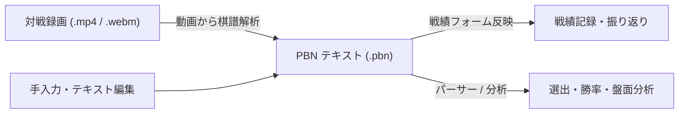

本書は、『Pokémon Champions』の対戦経過をテキストで記録・共有・解析するための棋譜フォーマット **PBN（Pokémon Battle Notation, `.pbn`）** の公式リファレンスです。

## 1. PBN とは

PBN は、人間がエディタ上でそのまま読み書き・手修正できることを最優先に設計された、行指向の対戦棋譜 DSL（ドメイン固有言語）です。

- **『Pokémon Champions』準拠の表現**:
  - 努力値（EV）は各能力 **0〜32・合計上限 66** の Champions 独自スケールに対応しています。
  - オープンチームシート（OTS）とクローズドチームシート（CTS）の情報の非対称性（判明済みの相手ポケモンのみ記録し、未判明枠は `?` で表現）を自然に記述できます。
- **因果関係スコープ（`{ ... }`）**:
  - 技のダメージ・追加効果・被弾リアクション（オボンのみ・特性発動など）や、繰り出し時の入場特性・天候／フィールド展開を波括弧ブロックで構造化します。
- **動画棋譜解析との統合**:
  - 対戦録画からの自動抽出タイムスタンプ（`@t=...ms`）を各ターンに保持でき、動画シークと棋譜の照合・手修正をシームレスに行えます。



---

## 2. ファイル全体構成

空行および `#` から始まる行はコメントとして扱われます。PBN ドキュメントは以下の順序で構成されます。

```pbn
[PBN "1.0"]                         # 1. ヘッダ（仕様バージョン・レギュレーション・勝敗等）
[Regulation "M-C"]
[Sheet "CTS"]
[Result "WIN"]

@p1 0 gengar @ gengarite | ...      # 2. 自軍パーティ（6体）
...
@select 0, 1, 3, 2                  # 3. 自軍選出（先発2体, 控え2体）

@p2 0 torkoal                       # 4. 相手見せ合いパーティ（6体）
...

@lead @t=62000ms                    # 5. 先発繰り出し（Turn 0）
  switch p2b torkoal 100%
  switch p2a trevenant 100%
  switch p1a gengar 165/165
  switch p1b incineroar 202/202 {
    ability p1b intimidate
  }

@turn 1 @t=75000ms                  # 6. ターンセクション（1ターンごと）
  @field Sandstorm 5/5 | Grassy 4/5
  @state
  p1:
    | active:
        p1a: gengar 165/165
        p1b: incineroar 202/202
    | bench: rillaboom 207/207, hippowdon 215/215
  p2:
    | active:
        p2a: trevenant 100%
        p2b: torkoal 100%
    | bench: ? 100%, ? 100%
  @cmd p1a: shadow-ball p2b +mega | p1b: fake-out p2a
  mega p1a gengar-mega
  move p1b fake-out {
    p2a: 100% -> 93%
  }
  ...

  # the battle has ended due to all pokemon fainting
```

---

## 3. ヘッダ・メタデータ

ファイル先頭に `[Tag "Value"]` 形式で記述します。

| タグ         | 必須 | 値の例                                      | 説明                                                             |
| :----------- | :--- | :------------------------------------------ | :--------------------------------------------------------------- |
| `PBN`        | 必須 | `"1.0"`                                     | PBN フォーマットのバージョン。                                   |
| `Regulation` | 必須 | `"M-A"`, `"M-B"`, `"M-C"`                   | 公式レギュレーション識別子。                                     |
| `Sheet`      | 必須 | `"CTS"` / `"OTS"`                           | クローズドチームシート（CTS）またはオープンチームシート（OTS）。 |
| `Result`     | 必須 | `"WIN"` / `"LOSS"` / `"DRAW"` / `"UNKNOWN"` | 対戦結果（P1 視点）。                                            |
| `Rating`     | 任意 | `"1845.181"`                                | 対戦終了後に表示されたレート値。                                 |

---

## 4. パーティ・選出ディレクティブ

### 4.1 自軍パーティ (`@p1`)

登録インデックス `0`〜`5` に対して、種族・もちもの・特性・性格と努力値・Lv.50 実数値・技構成を `|` 区切りで記述します。

```pbn
@p1 <idx> <species> [@ <item>] | <ability> | <Nature> [<EVs>] | <H,A,B,C,D,S> | <move1, move2, move3, move4>
```

- **識別子（スラッグ）**: 種族・もちもの・特性・技はすべて小文字ハイフン区切りの正規スラッグ（例: `sitrus-berry`, `grassy-surge`, `parting-shot`）を使用します。
- **努力値（Champions 32/66 形式）**: `H`, `A`, `B`, `C`, `D`, `S` に `0`〜`32` の数値を付けて記述します。性格の上昇補正は `+`、下降補正は `-` を末尾に付与します（例: `Timid H30 C5 D24 S7+`）。

### 4.2 自軍選出 (`@select`)

`@p1` の登録インデックスを **先発2体（`p1a`, `p1b`）→ 控え2体** の順にカンマ区切りで記述します。

```pbn
@select 0, 1, 3, 2
```

### 4.3 相手見せ合いパーティ (`@p2`)

CTS では種族スラッグのみを記述します。OTS や判明情報を追記する場合は `@p1` と同様に `@ item | ability | moves` を併記できます。

```pbn
@p2 0 torkoal
@p2 1 snorlax
@p2 2 trevenant
@p2 3 sinistcha
@p2 4 swampert
@p2 5 pelipper
```

---

## 5. リード・ターン構造

### 5.1 スロット識別子と HP 表記

| スロット      | 意味                 | HP 表記                                          |
| :------------ | :------------------- | :----------------------------------------------- |
| `p1a` / `p1b` | 自軍 左 / 右スロット | 実数値 `現在HP/最大HP`（例: `165/165`、`0/165`） |
| `p2a` / `p2b` | 相手 左 / 右スロット | 割合 `0%`〜`100%`（例: `93%`、`0%`）             |

### 5.2 リード (`@lead`)

ターン 1 開始前の先発繰り出しと入場時特性・天候／フィールド発動を記述します。

```pbn
@lead @t=62000ms
  switch p2b torkoal 100%
  switch p2a trevenant 100%
  switch p1a gengar 165/165
  switch p1b incineroar 202/202 {
    ability p1b intimidate
  }
```

### 5.3 ターンヘッダと状態スナップショット (`@turn`, `@field`, `@state`, `@cmd`)

各ターンの先頭では、有効な場の状態（`@field`）、盤面スナップショット（`@state`）、プレイヤーの入力コマンド（`@cmd`）を記述します。

- **`@field`**: ターン開始時点で有効な天候・フィールド・場の効果と、**残りターン / 最大ターン** を `|` 区切りで記述します（例: `Sandstorm 5/5 | Grassy 4/5 | Trick Room 3/5`）。ターン経過ごとに `5/5` → `4/5` → … → `1/5` とカウントダウンします。なお、死に出し（ターン終了時のひんし交代）で展開された天候・フィールドは、次のターン開始時に `5/5`（またはアイテム延長時 `8/8`）から始まります。
- **`@state`**:
  - `active:` に場の各スロットの種族・HP・状態異常（`[brn]`, `[par]`, `[slp]`, `[psn]`, `[tox]`, `[frz]`）・能力ランク変化（`(atk -1, spd +1)`）を記述します。
  - `bench:` に控えポケモンを記述します。ひんし済みは `fnt`、相手の未登場枠は `? 100%` と表記します。
- **`@cmd`**: 自軍 2 体の選択行動を `|` 区切りで記述します。
  - 技使用: `<move_id> [<target_slot>] [+mega]`（例: `shadow-ball p2b +mega`）
  - 交代: `switch <species>`（例: `switch incineroar`）
  - 未確定 / パス: `?` / `pass`

```pbn
@turn 4 @t=320000ms
  @field Sandstorm 4/5 | Grassy 3/5 | Trick Room 2/5
  @state
  p1:
    | active:
        p1a: hippowdon 215/215
        p1b: rillaboom 183/207
    | bench: gengar-mega fnt, incineroar 120/202
  p2:
    | active:
        p2a: trevenant 98%
        p2b: torkoal 90%
    | bench: ? 100%, ? 100%
  @cmd p1a: high-horsepower p2b | p1b: switch incineroar
```

---

## 6. イベント構文リファレンス

ターン内に発生したアクションと結果は、実機での発生順に 1 行 1 イベントで記述します。因果関係のある付随イベントは `{ ... }` ブロックでネストします。

### 6.1 イベント一覧

| コマンド  | 構文                                          | 説明・例                                                                                                                            |
| :-------- | :-------------------------------------------- | :---------------------------------------------------------------------------------------------------------------------------------- |
| `mega`    | `mega <slot> <species>`                       | メガシンカ。例: `mega p1a gengar-mega`                                                                                              |
| `move`    | `move <slot> <move_id> [{ ... }]`             | 技の発動。単行結果（`{ protected }`, `{ missed }`, `{ failed }`, `{ immune }`）または複数行ブロックで対象ダメージ・追加効果を内包。 |
| `switch`  | `switch <slot> <species> <hp> [{ ... }]`      | 交代・繰り出し。入場時特性や天候・フィールド変化を `{ ... }` に内包。                                                               |
| `ability` | `ability <slot> <ability_id>`                 | 特性の発動。例: `ability p1b intimidate`                                                                                            |
| `item`    | `item <slot> <item_id>`                       | もちものの発動・消費。例: `item p1a occa-berry`                                                                                     |
| `damage`  | `damage <slot> <before> -> <after> [<cause>]` | 定数ダメージ・反動・スリップダメージ等。例: `damage p1b 110/202 -> 60/202 [recoil]`、`damage p2b 90% -> 84% [sandstorm]`            |
| `heal`    | `heal <slot> <before> -> <after> [<cause>]`   | HP 回復。例: `heal p1b 84/202 -> 134/202 [sitrus-berry]`、`heal p1a 146/215 -> 159/215 [leftovers]`                                 |
| `boost`   | `boost <slot> <stat> <+N\|-N>`                | 能力ランク変化（`atk`, `def`, `spa`, `spd`, `spe`, `accuracy`, `evasion`）。例: `boost p2b atk -1`                                  |
| `status`  | `status <slot> <+status\|-status>`            | 状態異常・状態変化の付与または解除。例: `status p1a +brn`、`status p2a +destiny-bond`                                               |
| `cant`    | `cant <slot> <reason>`                        | 行動不能。例: `cant p2b flinch`、`cant p1a par`                                                                                     |
| `perish`  | `perish <slot> <count> [{ faint <slot> }]`    | ほろびのうたの残りカウント（`3` / `2` / `1` / `0`）。`0` 到達時は `{ faint <slot> }` でひんしを内包。                               |
| `faint`   | `faint <slot> [<cause>]`                      | 戦闘不能。みちづれ等の直接要因がある場合は `[destiny-bond]` を付与。                                                                |
| `weather` | `weather <Weather>`                           | 天候変化（`Rain`, `HarshSunlight`, `Sandstorm`, `Snow`, `None`）。                                                                  |
| `terrain` | `terrain <Terrain>`                           | フィールド変化（`Electric`, `Grassy`, `Misty`, `Psychic`, `None`）。                                                                |
| `field`   | `field <condition> <on\|off>`                 | 全体場の変化（`trick-room`, `gravity`, `wonder-room`, `magic-room` 等）。                                                           |
| `side`    | `side <p1\|p2> <condition> <on\|off>`         | サイド条件の変化（`tailwind`, `reflect`, `light-screen`, `aurora-veil`, `wide-guard` 等）。                                         |

### 6.2 `move` ブロック内の対象行とリアクション

`move` ブロック内では、各対象への HP 変化を `<slot>: <before> -> <after>` で簡潔に記述します。被弾時にオボンのみや特性が発動した場合は、さらに入れ子の `{ ... }` ブロックにまとめます。

```pbn
  move p2a eruption {
    p1a: 215/215 -> 133/215
    p1b: 120/202 -> 84/202 {
      heal p1b 84/202 -> 134/202 [sitrus-berry]
    }
  }
```

### 6.3 ほろびのうた (`perish`) とみちづれ (`faint ... [destiny-bond]`)

- **ほろびのうた**: 残りカウントは単一数値（`3` / `2` / `1` / `0`）で記述し、`0` によるひんしは `{ faint <slot> }` ブロックに内包します。

```pbn
  perish p1a 1
  perish p2a 0 {
    faint p2a
  }
```

- **みちづれ**: 攻撃によって倒されたポケモンのみちづれで攻撃側がひんしになった場合、`faint <slot> [destiny-bond]` として原因を明示します。

```pbn
  move p1a shadow-ball {
    p2a: 93% -> 0%
    faint p2a
    faint p1a [destiny-bond]
  }
```

### 6.4 対戦終了コメント

棋譜の末尾には、対戦が終了したこととその理由を示すコメント行を必ず記述します（勝敗そのものはヘッダの `[Result "..."]` で表すため、コメントには終了理由のみを記述します）。

| 終了理由           | コメント行                                                             |
| :----------------- | :--------------------------------------------------------------------- |
| 全ポケモンひんし   | `# the battle has ended due to all pokemon fainting`                   |
| 降参               | `# the battle has ended due to a forfeit`                              |
| 相手の持ち時間切れ | `# the battle has ended due to the opposing player's time running out` |
| 自分の持ち時間切れ | `# the battle has ended due to your time running out`                  |
| 総合時間切れ       | `# the battle has ended due to time running out`                       |
| 理由不明           | `# the battle has ended`                                               |

---

## 7. 実戦棋譜サンプル

```pbn
[PBN "1.0"]
[Regulation "M-C"]
[Sheet "CTS"]
[Result "LOSS"]

@p1 0 gengar @ gengarite | cursed-body | Timid H30 C5 D24 S7+ | 165,76,80,155,119,150 | shadow-ball, sludge-bomb, perish-song, protect
@p1 1 incineroar @ sitrus-berry | intimidate | Sassy H32 B18 D16+ | 202,135,128,100,138,72 | flare-blitz, parting-shot, fake-out, protect
@p1 2 rillaboom @ miracle-seed | grassy-surge | Sassy H32 B13 D21+ | 207,145,123,80,122,94 | grassy-glide, u-turn, fake-out, protect
@p1 3 hippowdon @ leftovers | sand-stream | Sassy H32 B6 D28+ | 215,132,144,88,132,60 | high-horsepower, stone-edge, yawn, protect
@p1 4 kingambit @ life-orb | defiant | Adamant H30 A32+ D3 S1 | 205,205,140,72,108,71 | kowtow-cleave, sucker-punch, swords-dance, protect
@p1 5 sneasler @ grassy-seed | unburden | Jolly A32 B2 S32+ | 155,182,82,54,100,189 | close-combat, dire-claw, acrobatics, protect
@select 0, 1, 3, 2

@p2 0 torkoal
@p2 1 snorlax
@p2 2 trevenant
@p2 3 sinistcha
@p2 4 swampert
@p2 5 pelipper

@lead @t=62000ms
  switch p2b torkoal 100%
  switch p2a trevenant 100%
  switch p1a gengar 165/165
  switch p1b incineroar 202/202 {
    ability p1b intimidate
  }

@turn 1 @t=75000ms
  @state
  p1:
    | active:
        p1a: gengar 165/165
        p1b: incineroar 202/202
    | bench: hippowdon 215/215, rillaboom 207/207
  p2:
    | active:
        p2a: trevenant 100%
        p2b: torkoal 100%
    | bench: ? 100%, ? 100%
  @cmd p1a: shadow-ball p2b +mega | p1b: fake-out p2a
  mega p1a gengar-mega
  move p1b fake-out {
    p2a: 100% -> 93%
  }
  move p1a shadow-ball {
    p2b: 100% -> 6%
  }
  move p2a trick-room {
    field trick-room on
  }

@turn 2 @t=132000ms
  @field Trick Room 4/5
  @state
  p1:
    | active:
        p1a: gengar-mega 165/165
        p1b: incineroar 202/202
    | bench: hippowdon 215/215, rillaboom 207/207
  p2:
    | active:
        p2a: trevenant 93%
        p2b: torkoal 6%
    | bench: ? 100%, ? 100%
  @cmd p1a: shadow-ball p2a | p1b: parting-shot
  move p2a destiny-bond
  move p1b parting-shot
  switch p1b rillaboom 207/207 {
    ability p1b grassy-surge
    terrain Grassy
  }
  move p1a shadow-ball {
    p2a: 93% -> 0%
    faint p2a
    faint p1a [destiny-bond]
  }
  switch p1a hippowdon 215/215 {
    ability p1a sand-stream
    weather Sandstorm
  }

  # the battle has ended due to a forfeit
```

---

## 8. 形式文法 (EBNF)

```ebnf
<pbn_document>       ::= { <blank_or_comment> }*
                         { <header_line> { <blank_or_comment> }* }*
                         { <p1_directive> { <blank_or_comment> }* }*
                         [ <select_directive> { <blank_or_comment> }* ]
                         { <p2_directive> { <blank_or_comment> }* }*
                         [ <lead_section> { <blank_or_comment> }* ]
                         { <turn_section> { <blank_or_comment> }* }*

<blank_or_comment>   ::= [<indent>] [ "#" <any_text> ] <newline>

<header_line>        ::= "[" <tag_name> <ws> '"' <tag_value> '"' "]" <newline>
<tag_name>           ::= "PBN" | "Regulation" | "Sheet" | "Result" | "Rating" | <ident>

<p1_directive>       ::= "@p1" <ws> <idx> <ws> <species> [ <ws> "@" <ws> <item_id> ]
                         <ws> "|" <ws> <ability_id>
                         <ws> "|" <ws> <nature_spread>
                         <ws> "|" <ws> <stats_six>
                         <ws> "|" <ws> <moves_list> <newline>
<select_directive>   ::= "@select" <ws> <idx> { "," [<ws>] <idx> }* <newline>
<p2_directive>       ::= "@p2" <ws> <idx> <ws> <species>
                         [ <ws> "@" <ws> <item_id> ]
                         [ <ws> "|" <ws> <ability_id> ]
                         [ <ws> "|" <ws> <moves_list> ] <newline>

<lead_section>       ::= "@lead" { <ws> <turn_meta> }* <newline>
                         { <turn_event> | <blank_or_comment> }*
<turn_section>       ::= "@turn" <ws> <number> { <ws> <turn_meta> }* <newline>
                         { <blank_or_comment> }*
                         [ <field_line> { <blank_or_comment> }* ]
                         [ <state_section> { <blank_or_comment> }* ]
                         [ <cmd_line> { <blank_or_comment> }* ]
                         { <turn_event> | <blank_or_comment> }*

<turn_meta>          ::= "@t=" <number> "ms"
                       | "@eval=" [ "+" | "-" ] <float> "%"
                       | "@best=" '"' <any_char_except_quote>* '"'
                       | "@quality=" ("Best" | "Good" | "Inaccuracy" | "Blunder")

<field_line>         ::= [<indent>] "@field" <ws> <field_item> { <ws> "|" <ws> <field_item> }* <newline>
<field_item>         ::= <condition_name> <ws> <number> "/" <number>

<cmd_line>           ::= [<indent>] "@cmd" <ws> "p1a:" <ws> <slot_action> <ws> "|" <ws> "p1b:" <ws> <slot_action> <newline>
<slot_action>        ::= "switch" <ws> <species>
                       | <move_id> [ <ws> <slot> ] [ <ws> "+mega" ]
                       | "pass"
                       | "?"

<turn_event>         ::= <mega_line>
                       | <move_block>
                       | <switch_block>
                       | <ability_block>
                       | <item_block>
                       | <damage_line>
                       | <heal_line>
                       | <boost_line>
                       | <status_line>
                       | <cant_line>
                       | <perish_block>
                       | <faint_line>
                       | <field_event>

<move_block>         ::= [<indent>] "move" <ws> <slot> <ws> <move_id> [ <ws> <event_scope> ] <newline>
<switch_block>       ::= [<indent>] "switch" <ws> <slot> <ws> <species> <ws> <hp_val> [ <ws> <event_scope> ] <newline>
<perish_block>       ::= [<indent>] "perish" <ws> <slot> <ws> ("3" | "2" | "1" | "0") [ <ws> <event_scope> ] <newline>
<faint_line>         ::= [<indent>] "faint" <ws> <slot> [ <ws> <cause_id> ] <newline>
<damage_line>        ::= [<indent>] "damage" <ws> <slot> <ws> <hp_val> " -> " <hp_val> [ <ws> <cause_id> ] <newline>
<heal_line>          ::= [<indent>] "heal" <ws> <slot> <ws> <hp_val> " -> " <hp_val> [ <ws> <cause_id> ] <newline>
<cause_id>           ::= "[" <slug> "]"

<slot>               ::= "p1a" | "p1b" | "p2a" | "p2b"
<hp_val>             ::= <number> "%" | <number> "/" <number> | "0" | "fnt" | "?"
```
