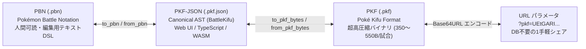

# PKF / PBN 棋譜フォーマット仕様書・公式ガイド (v1.0)

本書は、『Pokémon Champions』（公式ダブルバトル / VGC形式）における対戦の記録・動画OCR抽出・AI評価値解析・Web共有を一貫して扱うための **棋譜フォーマット体系「PKF (Poké Kifu Format) / PBN (Pokémon Battle Notation)」** の人間可読な総合リファレンスです。

## 1. なぜ新しい棋譜フォーマットが必要なのか？

### 既存フォーマット（Showdown Replay / バトルビデオログ）の課題

1. **『Pokémon Champions』独自のメタゲーム規約**:
   - 努力値スケールが従来の 0〜252 ではなく **0〜32段階（合計上限66）**。
   - オープンチームシート（OTS）とクローズドチームシート（CTS）の情報の非対称性。
   - 過去世代のメガシンカ要素と現代ダブル仕様の融合。
2. **動画キャプチャOCRとAI評価値解析の統合**:
   実機の対戦録画からOCRで自動抽出した証跡（動画タイムスタンプ `@t=...ms`、認識信頼度 `@conf=...`、要目視確認フラグ `@review`）や、MCTS/GTOソルバーによる各ターンの推奨最善手・ミス分類（`@best`, `@quality`）を単一の棋譜に注釈として保持できる標準規格が存在しませんでした。

## 2. 3層同型アーキテクチャ (3-Tier Isomorphic Architecture)

PKFフォーマット体系は、用途の異なる3つの表現形式が同一の抽象構文木（AST: `BattleKifu`）を介して **完全に可逆（Lossless）に相互変換** できるように設計されています。



| フォーマット | 拡張子 / MIME | 主な用途 | 特徴 |
| :--- | :--- | :--- | :--- |
| **PBN**<br>(Pokémon Battle Notation) | `.pbn`<br>`text/x-pbn` | 人間による閲覧・手修正・Git管理・SNS共有・動画OCR出力 | 1行1イベントの行指向テキストDSL。将棋の棋譜のように直感的に読め、エディタで直接編集可能。 |
| **PKF**<br>(Poké Kifu Format) | `.pkf`<br>`application/vnd.poketistix.pkf` | ファイル保存・DB格納・URLパラメータ埋め込み | 数値辞書と1バイトOpcodeで極限まで圧縮。1試合が **約350〜550バイト** に収まる。 |
| **PKF-JSON** | `.pkf.json`<br>`application/json` | Webフロントエンド・API・WASM入出力 | Rust (`kifu.rs`) と TypeScript (`tsify`) で相互運用される標準データ構造。 |

---

## 3. PBN (Pokémon Battle Notation, `.pbn`) 実践ガイド

PBNは、テキストエディタで人間が読む・書く・編集することを最優先にしたフォーマットです。空行および `#` から始まる行はコメントとして無視されます。

### 3.1 PBN ファイルの全体構成

```text
[PBN "1.0"]                      <- ヘッダ: メタデータ（レギュレーション、シート形式、勝敗等）
[Regulation "M-C"]
[Sheet "CTS"]
[Result "WIN"]

@p1 0 raichu @ raichunite-y ...   <- 自軍パーティ（完全情報: 努力値・実数値・技4つ）
...
@select 5, 1, 2, 4               <- 選出4匹（先発2匹 + 後発2匹の登録インデックス）

@p2 0 golisopod                  <- 相手見せ合いパーティ（CTSなら種族のみ、OTSなら持ち物等も記述）
...

@lead @t=106000ms                <- ターン0: 先発繰り出しと入場時特性
  switch p2a garchomp 100%
  ...

@turn 1 @t=115000ms              <- ターン1: ターン開始時情報
  @field Rain 1/5                <- ターン開始時に有効な天候・フィールド（経過/最大）
  @state
  p1:
    | active: salamence 172/172, incineroar 234/234
    | bench: rillaboom 209/209, volcarona 224/224
  p2:
    | active: garchomp 100%, farigiraf 100%
    | bench: 2 alive
  @cmd p1a: protect | p1b: snarl <- プレイヤーの入力コマンド
  move p1a protect ...           <- ターン内に発生したアクション・イベント
  ...
```

---

### 3.2 実戦棋譜による逐行ウォークスルー

以下は、実機対戦録画のOCR解析から生成された完全な PBN の実例と、各セクションの解説です。

```text
[PBN "1.0"]
[Regulation "M-C"]
[Sheet "CTS"]
[Result "WIN"]

# ==============================================================================
# P1（自軍）パーティ登録情報 (6匹)
# 書式: @p1 <idx> <slug> @ <item> | <ability> | <性格・努力値> | <実数値> | <技構成>
# ==============================================================================
@p1 0 raichu @ raichunite-y | lightning-rod | Timid H24 B10 S32+ | 183,99,95,110,100,213 | zap-cannon, focus-blast, encore, protect
@p1 1 incineroar @ sitrus-berry | intimidate | Impish H32 A3 B10+ D11 S10 | 234,141,143,90,132,100 | flare-blitz, snarl, parting-shot, fake-out
@p1 2 rillaboom @ miracle-seed | grassy-surge | Adamant H17 A26+ S23 | 209,216,110,72,90,151 | grassy-glide, wood-hammer, high-horsepower, fake-out
@p1 3 basculegion-male @ choice-scarf | adaptability | Jolly H1 A32 B1 S32+ | 197,196,87,90,95,178 | last-respects, wave-crash, flip-turn, icy-wind
@p1 4 volcarona @ grassy-seed | flame-body | Modest H32 B29 C5+ | 224,72,143,181,125,120 | overheat, struggle-bug, rage-powder, tailwind
@p1 5 salamence @ salamencite | intimidate | Mild H1 C32+ D1 S32 | 172,155,90,213,102,184 | hyper-voice, double-edge, tailwind, protect

# 選出4匹: 先発(ボーマンダ#5, ガオガエン#1), 後発(ゴリランダー#2, ウルガモス#4)
@select 5, 1, 2, 4

# ==============================================================================
# P2（相手）見せ合い情報 (6匹)
# CTS（クローズド）時は判明種族のみ。OTS（オープン）時は @ item | ability | moves を併記可
# ==============================================================================
@p2 0 golisopod
@p2 1 rillaboom
@p2 2 farigiraf
@p2 3 pelipper
@p2 4 garchomp
@p2 5 archaludon

# ==============================================================================
# リード（Turn 0）: 先発の繰り出しと入場時特性の発動順序
# ==============================================================================
@lead @t=106000ms
  switch p2b farigiraf 100%
  switch p2a garchomp 100%
  switch p1a salamence 172/172
  switch p1b incineroar 234/234
  ability p1a intimidate {
    target p2a: atk -1
    target p2b: atk -1
  }
  ability p1b intimidate {
    target p2a: atk -1
    target p2b: atk -1
  }

# ==============================================================================
# Turn 1: 相手メガシンカ + てだすけ + まもる（竜の波動遮断）+ バークアウト
# ==============================================================================
@turn 1 @t=120000ms
  @cmd p1a: protect | p1b: snarl
  mega p2a garchomp-mega-z
  move p2b helping-hand -> p2a
  move p1a protect
  move p2a dragon-pulse -> p1a { protected }
  move p1b snarl {
    target p2a: 100% -> 88%, spa -1
    target p2b: 100% -> 80%, spa -1
  }

# ==============================================================================
# Turn 2: 交代 + グラスメイカー + トリックルーム始動
# ==============================================================================
@turn 2 @t=174000ms
  @cmd p1a: switch rillaboom | p1b: snarl
  switch p2a archaludon 100%
  switch p1a rillaboom 209/209 {
    ability p1a grassy-surge
    terrain Grassy
  }
  move p1b snarl {
    target p2a: 100% -> 92%, spa -1 {
      ability p2a stamina
      boost p2a def +1
    }
    target p2b: 80% -> 62%, spa -1
  }
  move p2b trick-room {
    field trick-room on
  }

# ==============================================================================
# Turn 3: ターン開始時にグラスフィールドとトリックルームが有効 (2/5ターン目)
# ==============================================================================
@turn 3 @t=391000ms
  @field
    | entire: Grassy 2/5, Trick Room 2/5
    | p1: Tailwind 2/4
  @state
  p1:
    | active: rillaboom 209/209, incineroar 234/234
    | bench: volcarona 224/224, salamence fnt
  p2:
    | active: archaludon 92% (def +1, spa -1), farigiraf 62% [par] (spa -1)
    | bench: golisopod 100%, ? 100%
  @cmd p1a: wood-hammer -> p2b | p1b: flare-blitz -> p2b
  move p2b electro-shot {
    target p1b: 234/234 -> 126/234
  }
```

---

## 4. PBN 形式文法仕様 (Formal EBNF Grammar v1.0 Revised)

PBN は行指向のドメイン固有言語（DSL）です。
波括弧 `{ ... }` により技の対象、被弾リアクション、入場時特性等の因果関係スコープが明示的に閉じられます。

```ebnf
/* ========================================================================== */
/* PBN ドキュメント全体構造 (v1.0 Revised)                                    */
/* ========================================================================== */
<pbn_document>        ::= { <blank_or_comment> }*
                          { <header_line> { <blank_or_comment> }* }*
                          { <team_directive> { <blank_or_comment> }* }*
                          [ <select_directive> { <blank_or_comment> }* ]
                          { <preview_directive> { <blank_or_comment> }* }*
                          [ <lead_section> { <blank_or_comment> }* ]
                          { <turn_section> { <blank_or_comment> }* }*

<blank_or_comment>    ::= [<indent>] [ "#" <any_text> ] <newline>

/* -------------------------------------------------------------------------- */
/* 1. ヘッダ・メタデータ ([Tag "Value"])                                      */
/* -------------------------------------------------------------------------- */
<header_line>         ::= [<indent>] "[" <tag_name> <ws> '"' <tag_value> '"' "]" [<ws>] <newline>
<tag_name>            ::= "PBN" | "Regulation" | "Sheet" | "Result" | "Rating" | <ident>
<tag_value>           ::= <any_char_except_quote>*

/* -------------------------------------------------------------------------- */
/* 2. パーティ登録・見せ合いディレクティブ (@p1, @p2, @select)                */
/* -------------------------------------------------------------------------- */
<team_directive>      ::= [<indent>] "@p1" <ws> <idx> <ws> <species> [ <ws> "@" <ws> <item_id> ]
                          <ws> "|" <ws> <ability_id>
                          <ws> "|" <ws> <nature_spread>
                          <ws> "|" <ws> <stats_six>
                          <ws> "|" <ws> <moves_list> [<ws>] <newline>

<select_directive>    ::= [<indent>] "@select" <ws> <idx> { [<ws>] "," [<ws>] <idx> }* [<ws>] <newline>

<preview_directive>   ::= [<indent>] "@p2" <ws> <idx> <ws> <species>
                          [ <ws> "@" <ws> <item_id> ]
                          [ <ws> "|" <ws> <ability_id> ]
                          [ <ws> "|" <ws> <nature_spread> ]
                          [ <ws> "|" <ws> <stats_six> ]
                          [ <ws> "|" <ws> <moves_list> ] [<ws>] <newline>

<nature_spread>       ::= <nature_name> { <ws> <ev_alloc> }*
<ev_alloc>            ::= ("H" | "A" | "B" | "C" | "D" | "S") <number> [ "+" | "-" ]
<stats_six>           ::= <stat_val> "," [<ws>] <stat_val> "," [<ws>] <stat_val> "," [<ws>] <stat_val> "," [<ws>] <stat_val> "," [<ws>] <stat_val>
<stat_val>            ::= <number> | "?"
<moves_list>          ::= <move_id> { [<ws>] "," [<ws>] <move_id> }*

/* -------------------------------------------------------------------------- */
/* 3. ターンセクション (@lead, @turn)                                         */
/* -------------------------------------------------------------------------- */
<lead_section>        ::= [<indent>] "@lead" { <ws> <turn_meta> }* [<ws>] <newline>
                          { <lead_event> | <blank_or_comment> }*

<turn_section>        ::= [<indent>] "@turn" <ws> <number> { <ws> <turn_meta> }* [<ws>] <newline>
                          { <blank_or_comment> }*
                          [ <field_state_section> { <blank_or_comment> }* ]
                          [ <team_state_section> { <blank_or_comment> }* ]
                          [ <cmd_line> { <blank_or_comment> }* ]
                          [ <p2cmd_line> { <blank_or_comment> }* ]
                          { <turn_event> | <blank_or_comment> }*

<turn_meta>           ::= "@t=" <number> "ms"
                        | "@eval=" [ "+" | "-" ] <float> "%"
                        | "@best=" '"' <any_char_except_quote>* '"'
                        | "@quality=" ("Best" | "Good" | "Inaccuracy" | "Blunder")
                        | <meta_token>

<field_state_section> ::= [<indent>] "@field" [ <ws> <field_scope_line> ] [<ws>] <newline>
                          { [<indent>] "|" <ws> <field_scope_line> [<ws>] <newline> }*

<field_scope_line>    ::= [ "|" <ws> ] <field_scope_item> { [<ws>] "|" <ws> <field_scope_item> }*

<field_scope_item>    ::= <field_scope> ":" <ws> <cond_item_list>
<field_scope>         ::= "entire" | "p1" | "p2"

<cond_item_list>      ::= <field_cond_item> { [<ws>] "," <ws> <field_cond_item> }*
<field_cond_item>     ::= <condition_name> <ws> <number> "/" <number>

<team_state_section>  ::= [<ws_opt>] "@state" [<ws_opt>] <newline>
                          { [<ws_opt>] <side_header> [<ws_opt>] <newline>
                            { [<ws_opt>] "|" [<ws_opt>] <side_item> [<ws_opt>] <newline> }* }*

<side_header>         ::= "p1:" | "p2:"
<side_item>           ::= "active:" [ <ws_opt> <newline> <active_poke_block> | <ws> <active_poke_list> ]
                        | "bench:" <ws> <bench_poke_list>
<active_poke_block>   ::= { [<ws_opt>] <poke_entry> [<ws_opt>] <newline> }+
<active_poke_list>    ::= <poke_entry> { [<ws_opt>] "," [<ws_opt>] <poke_entry> }*
<bench_poke_list>     ::= <bench_entry> { [<ws_opt>] "," [<ws_opt>] <bench_entry> }*

<poke_entry>          ::= <slot> ":" <ws> <species> <ws> <hp_val> [ <ws> <status_sequence> ] [ <ws> <stat_boost_scope> ]
<status_sequence>     ::= "[" <status_item> { "," <ws> <status_item> }* "]"
<status_item>         ::= <major_status> | <volatile_status>
<major_status>        ::= "par" | "brn" | "slp" | "psn" | "tox" | "frz"
<volatile_status>     ::= <volatile_id> [ ":" <ws> <number> ]
<volatile_id>         ::= "perish" | "taunt" | "encore" | "disable" | "confusion" | "yawn" | "substitute" | "leech-seed" | "curse" | "salt-cure" | "focus-energy"

<stat_boost_scope>    ::= "(" <stat_boost_list> ")"
<stat_boost_list>     ::= <stat_boost> { [<ws>] "," [<ws>] <stat_boost> }*

<bench_entry>         ::= ( <species> | "?" ) [ <ws> ( <hp_val> | "fnt" ) ] [ <ws> "[" <status_id> "]" ]
                        | <number> <ws> ("alive" | "remaining")

<cmd_line>            ::= [<indent>] "@cmd" <ws> "p1a:" <ws> <slot_action> <ws> "|" <ws> "p1b:" <ws> <slot_action> [<ws>] <newline>
<p2cmd_line>          ::= [<indent>] "@p2cmd" <ws> "p2a:" <ws> <slot_action> <ws> "|" <ws> "p2b:" <ws> <slot_action> [<ws>] <newline>
<slot_action>         ::= "switch" <ws> <species>
                        | <move_id> [ <ws> "->" <ws> <slot> ] [ <ws> "+mega" ]
                        | "pass"
                        | "?"

/* -------------------------------------------------------------------------- */
/* 4. イベントブロック構文 (Event Hierarchy & Outcomes)                       */
/* -------------------------------------------------------------------------- */
<lead_event>          ::= <switch_block>
                        | <ability_block>
                        | <item_block>
                        | <field_event>

<turn_event>          ::= <mega_line>
                        | <move_block>
                        | <cant_line>
                        | <switch_block>
                        | <ability_block>
                        | <item_block>
                        | <field_event>
                        | <damage_line>
                        | <heal_line>
                        | <boost_line>
                        | <status_line>
                        | <faint_line>

/* メガシンカ・行動不能 */
<mega_line>           ::= [<indent>] "mega" <ws> <slot> <ws> <species> [ <ws> <item_id> ] { <ws> <meta_token> }* [<ws>] <newline>
<cant_line>           ::= [<indent>] "cant" <ws> <slot> <ws> <reason_id> [ <ws> <move_id> ] { <ws> <meta_token> }* [<ws>] <newline>

/* 技の実行ブロック (1行ブロック `{ protected }` と複数行ブロックの両対応) */
<move_block>          ::= <move_header> [ <ws> <move_scope> ] [<ws>] <newline>
<move_header>         ::= [<indent>] "move" <ws> <slot> <ws> <move_id> [ <ws> "->" <ws> <slot> ] { <ws> <meta_token> }*
<move_scope>          ::= "{" [<ws>] <inline_move_outcome> [<ws>] "}"
                        | "{" [<ws>] <newline> { <move_child_event> | <blank_or_comment> }* [<indent>] "}"

<inline_move_outcome> ::= "protected" | "missed" | "failed" | "immune"
<move_child_event>    ::= <target_block>
                        | [<indent>] <inline_move_outcome> { <ws> <meta_token> }* [<ws>] <newline>
                        | <field_event>
                        | <switch_block>
                        | <ability_block>
                        | <item_block>
                        | <damage_line>
                        | <heal_line>
                        | <boost_line>
                        | <faint_line>

/* 対象ごとの結果と被弾リアクション */
<target_block>        ::= [<indent>] ("target" <ws> | "->" <ws>) <slot> ":" <ws> <outcome_list> { <ws> <meta_token> }* [ <ws> <reaction_scope> ] [<ws>] <newline>
<outcome_list>        ::= <outcome_item> { [<ws>] "," [<ws>] <outcome_item> }*
<outcome_item>        ::= <damage_hp>
                        | <stat_boost>
                        | <status_change>
                        | "protected" | "missed" | "immune" | "crit" | "super-effective" | "resisted" | "fainted"

<damage_hp>           ::= <hp_val> <ws> "->" <ws> <hp_val>
<stat_boost>          ::= <stat_name> <ws> <stat_delta>
<stat_delta>          ::= ("+" | "-") ("1" | "2" | "3" | "4" | "5" | "6" | "12")
<status_change>       ::= ("+" | "-") <status_id>

/* 被弾・登場・特性リアクションスコープ */
<reaction_scope>      ::= "{" [<ws>] <newline> { <reaction_event> | <blank_or_comment> }* [<indent>] "}"
<reaction_event>      ::= <target_block>
                        | <ability_block>
                        | <item_block>
                        | <boost_line>
                        | <status_line>
                        | <damage_line>
                        | <heal_line>
                        | <switch_block>
                        | <field_event>
                        | <faint_line>

/* 交代ブロック (Switch Block) */
<switch_block>        ::= <switch_header> [ <ws> <reaction_scope> ] [<ws>] <newline>
<switch_header>       ::= [<indent>] "switch" <ws> <slot> <ws> <species> <ws> <hp_val> { <ws> <meta_token> }*

/* 特性・持ち物ブロック (単一行でも `{ ... }` 付き複合効果でも記述可能) */
<ability_block>       ::= <ability_header> [ <ws> <reaction_scope> ] [<ws>] <newline>
<ability_header>      ::= [<indent>] "ability" <ws> <slot> <ws> <ability_id> { <meta_token> }*

<item_block>          ::= <item_header> [ <ws> <reaction_scope> ] [<ws>] <newline>
<item_header>         ::= [<indent>] "item" <ws> <slot> <ws> <item_id> [ <ws> ("consumed" | "activated" | "revealed") ] { <ws> <meta_token> }*

/* 単一行プリミティブイベント */
<boost_line>          ::= [<indent>] "boost" <ws> <slot> <ws> <stat_name> <ws> <stat_delta> { <ws> <meta_token> }* [<ws>] <newline>
<status_line>         ::= [<indent>] "status" <ws> <slot> <ws> <status_change> [ <ws> <cause_id> ] { <ws> <meta_token> }* [<ws>] <newline>
<damage_line>         ::= [<indent>] "damage" <ws> <slot> <ws> <damage_hp> [ <ws> <cause_id> ] { <ws> <meta_token> }* [<ws>] <newline>
<heal_line>           ::= [<indent>] "heal" <ws> <slot> <ws> <damage_hp> [ <ws> <cause_id> ] { <ws> <meta_token> }* [<ws>] <newline>
<faint_line>          ::= [<indent>] "faint" <ws> <slot> { <ws> <meta_token> }* [<ws>] <newline>

/* 場の変化 (Field Events) */
<field_event>         ::= <weather_line> | <terrain_line> | <field_change_line> | <side_line>
<weather_line>        ::= [<indent>] "weather" <ws> ("Rain" | "HarshSunlight" | "Sandstorm" | "Snow" | "None") { <ws> <meta_token> }* [<ws>] <newline>
<terrain_line>        ::= [<indent>] "terrain" <ws> ("Electric" | "Grassy" | "Misty" | "Psychic" | "None") { <ws> <meta_token> }* [<ws>] <newline>
<field_change_line>   ::= [<indent>] "field" <ws> <field_condition> <ws> ("on" | "off") { <ws> <meta_token> }* [<ws>] <newline>
<side_line>           ::= [<indent>] "side" <ws> ("p1" | "p2") <ws> <side_condition> <ws> ("on" | "off" | <number>) { <ws> <meta_token> }* [<ws>] <newline>

/* -------------------------------------------------------------------------- */
/* 5. 終端記号・トークン定義 (Terminals & Tokens)                             */
/* -------------------------------------------------------------------------- */
<slot>                ::= "p1a" | "p1b" | "p2a" | "p2b"
<stat_name>           ::= "atk" | "def" | "spa" | "spd" | "spe" | "accuracy" | "evasion"
<status_id>           ::= "brn" | "par" | "slp" | "frz" | "psn" | "tox" | "confusion" | "taunt" | "encore" | <ident>
<hp_val>              ::= <percentage> | <exact_hp> | "0" | "fnt" | "?"
<percentage>          ::= <number> "%"
<exact_hp>            ::= <number> "/" <number>

<condition_name>      ::= "Trick Room" | "Gravity" | "Rain" | "HarshSunlight" | "Sandstorm" | "Snow"
                        | "Electric" | "Grassy" | "Misty" | "Psychic"
                        | "Tailwind" | "Reflect" | "Light Screen" | "Aurora Veil" | "Safeguard" | "Mist"
                        | "Stealth Rock" | "Spikes" | "Toxic Spikes" | "Sticky Web"
                        | <ident>
<field_condition>     ::= "trick-room" | "gravity" | "fairy-lock" | "wonder-room" | "magic-room" | <ident>
<side_condition>      ::= "tailwind" | "reflect" | "light-screen" | "aurora-veil" | "safeguard" | "mist"
                        | "stealth-rock" | "spikes" | "toxic-spikes" | "sticky-web" | "wide-guard" | "quick-guard" | <ident>

<idx>                 ::= "0" | "1" | "2" | "3" | "4" | "5"
<species>             ::= <slug>
<item_id>             ::= <slug>
<ability_id>          ::= <slug>
<move_id>             ::= <slug>
<reason_id>           ::= <slug>
<cause_id>            ::= "[" <slug> "]" | <slug>
<nature_name>         ::= "Hardy" | "Lonely" | "Brave" | "Adamant" | "Naughty"
                        | "Bold" | "Docile" | "Relaxed" | "Impish" | "Lax"
                        | "Timid" | "Hasty" | "Serious" | "Jolly" | "Naive"
                        | "Modest" | "Mild" | "Quiet" | "Bashful" | "Rash"
                        | "Calm" | "Gentle" | "Sassy" | "Careful" | "Quirky"

<slug>                ::= [a-z0-9]+ { "-" [a-z0-9]+ }*
<ident>               ::= [A-Za-z0-9_-]+
<number>              ::= [0-9]+
<float>               ::= [0-9]+ [ "." [0-9]+ ]

<indent>              ::= [ \t]*
<ws>                  ::= [ \t]+
<newline>             ::= [ "\r" ] "\n"

<meta_token>          ::= "@review"
                        | "@t=" <number> "ms"
                        | "@conf=" <float> [ "%" ]
                        | "@note=" '"' <any_char_except_quote>* '"'
                        | "[" <any_char_except_bracket>* "]"
```

---

## 5. PBN 構文リファレンス

### 5.1 ディレクティブ（ターン管理・コマンド・場の状態）

ディレクティブは `@` で始まる行です。

| ディレクティブ | 構文例 | 説明 |
| :--- | :--- | :--- |
| `@turn` | `@turn 1 @t=12000ms [@eval=64.2%] [@best="..."] [@quality=Best]` | ターンの開始。タイムスタンプやAI評価値・着手分類を付与可能。 |
| `@field` | `@field entire: Grassy 2/5, Trick Room 2/5 \| p1: Tailwind 2/4` | **ターン開始時に有効な場の状態**。全体（`entire`）・自陣（`p1`）・敵陣（`p2`）のスコープごとにカンマ区切りで集約し、スコープ間をパイプ `\|` で区切る。改行して `\|` から始まる継続行（パターンスタイル B）としても記述可能。 |
| `@state` | `@state\n  p1:\n    \| active: rillaboom 209/209, incineroar 234/234\n    \| bench: volcarona 224/224, salamence fnt\n  p2:\n    \| active: archaludon 92% (def +1), farigiraf 62% [par]\n    \| bench: golisopod 100%, ? 100%` | **ターン開始時のお互い（p1/p2）のポケモンの状態**。陣営（`p1:` / `p2:`）を親ブロックとし、インデント階層で `\| active: <場のポケモン>` と `\| bench: <控えの生存状況>` を記述。 |
| `@cmd` | `@cmd p1a: hyper-voice +mega \| p1b: flare-blitz` | 自軍プレイヤーが選択した入力行動（技名、交代先、メガシンカの有無）。 |
| `@p2cmd` | `@p2cmd p2a: protect \| p2b: trick-room` | 相手の選択行動（リプレイ等で判明している場合のみ任意で記述）。 |
| `@note="..."` / `[...]` | `@note="相手のねこだましをケアしつつメガシンカ"` | ターンまたはイベントに対するメタ情報・注釈コメント（旧 `{ ... }` から分離）。 |

> [!NOTE]
> **スロット識別子 (`PokemonIdent`)**:
> - `p1a`: 自軍（プレイヤー1）の左スロット
> - `p1b`: 自軍（プレイヤー1）の右スロット
> - `p2a`: 相手（プレイヤー2）の左スロット（画面向かって中央〜右寄り）
> - `p2b`: 相手（プレイヤー2）の右スロット（画面向かって右端）

---

### 5.2 主要命令一覧

| 命令 | 書式 | 役割 |
| :--- | :--- | :--- |
| `switch` | `switch <slot> <slug> <hp>` | 登場（交代・先発）。自軍は実数値 `curr/max`、相手は `XX%` で表記。`{ ... }` で入場時効果や交代理由スコープを持てる。 |
| `move` | `move <attacker> <move_id> [-> <target>]` | 技の使用宣言。単体技の場合は `->` で対象を指定。全体技の場合は対象を省略。`{ ... }` で対象結果や被弾リアクションを囲む。 |
| `target:` / `->` | `target <slot>: <damage_hp>, <stat_boost>` | 対象ごとの効果・解決結果行。全体技・拡散技のダメージや能力変化、状態異常を対象ごとに集約。 |
| `ability` | `ability <slot> <ability_id>` | 特性の発動宣言。単一行または `{ ... }` スコープで連鎖効果（じきゅうりょく等）を表現。 |
| `item` | `item <slot> <item_id> [consumed]` | 持ち物の発動・消費宣言。単一行または `{ ... }` スコープで表現。 |
| `boost` | `boost <slot> <stat> <delta>` | 能力ランク変動（例: `boost p2a def +1`）。 |
| `status` | `status <slot> <+\|-<status_id>> [<cause>]` | 状態異常・状態変化の付与・解除（例: `status p1a +par`, `status p1b -slp [lum-berry]`）。 |
| `damage` | `damage <slot> <damage_hp> [<cause>]` | 定数・スリップダメージ（天候、火傷、命の珠、ゴツゴツメット等）。 |
| `cant` | `cant <slot> <reason> [<move>]` | 行動不能（麻痺、睡眠、氷、怯み、挑発等）。 |
| `mega` | `mega <slot> <mega_species>` | メガシンカの発動。 |
| `terrain` | `terrain <Electric\|Grassy\|Misty\|Psychic\|None>` | フィールドの展開・終了。 |
| `weather` | `weather <Rain\|HarshSunlight\|Sandstorm\|Snow\|None>` | 天候の発生・終了。 |
| `field` | `field <trick-room\|gravity\|fairy-lock> <on\|off>` | トリックルーム等の全体場効果の開始/終了。 |
| `side` | `side <p1\|p2> <tailwind\|reflect> <on\|off>` | おいかぜ・壁等の陣地効果の開始/終了。 |
| `heal` | `heal <target> <damage_hp> [<cause>]` | HP回復（フィールド、残飯、きのみ、回復技等）。推移と原因を記録。 |
| `perish` | `perish <slot> <before> -> <after> [{ faint <slot> }]` | ほろびのうたのカウント減少。0到達時は `{ faint <slot> }` スコープで瀕死を内包。 |
| `faint` | `faint <target>` | 戦闘不能。 |

---

## 6. PKF (Poké Kifu Format, `.pkf`) バイナリ仕様

`.pkf` は、DBストレージやURL共有パラメータに最適化された **超高圧縮リトルエンディアン・バイナリフォーマット** です。

### 5.1 ファイルヘッダ (8 bytes)

```
0                   1                   2                   3
0 1 2 3 4 5 6 7 8 9 0 1 2 3 4 5 6 7 8 9 0 1 2 3 4 5 6 7 8 9 0 1
+-+-+-+-+-+-+-+-+-+-+-+-+-+-+-+-+-+-+-+-+-+-+-+-+-+-+-+-+-+-+-+-+
|       'P'     |       'K'     |       'F'     |  Version (1)  |
+-+-+-+-+-+-+-+-+-+-+-+-+-+-+-+-+-+-+-+-+-+-+-+-+-+-+-+-+-+-+-+-+
| Regulation ID |  Flags Bitset |          Turn Count           |
+-+-+-+-+-+-+-+-+-+-+-+-+-+-+-+-+-+-+-+-+-+-+-+-+-+-+-+-+-+-+-+-+
```

- **`Magic (3B)` + `Version (1B)`**: `0x50, 0x4B, 0x46, 0x01` (`"PKF\x01"`)
- **`Regulation ID (1B)`**: `0` = Champions M-A, `1` = M-B, `2` = M-C
- **`Flags Bitset (1B)`**:
  - `Bit 0`: `is_open_team_sheet` (0=CTS, 1=OTS)
  - `Bit 1`: `has_provenance` (動画タイムスタンプ・OCR信頼度フラグを含む)
  - `Bit 2`: `has_annotations` (AI評価値・最善手キャッシュを含む)
  - `Bit 3..4`: `result` (`00`=Unknown, `01`=P1Win, `10`=P2Win, `11`=Draw)
- **`Turn Count (2B, u16-LE)`**: ターン数

### 5.2 文字列テーブル (String Table)
1試合に登場するポケモン種族名・技名・特性名・アイテム名は高々30〜40種類です。ファイルの先頭にユニークなスラグ配列を一度だけ記録し、以降の全イベントではすべて **1バイト (`u8`) のインデックス** で参照します。

### 5.3 イベント Opcode のビットパッキング (1 byte + ペイロード)
スロット識別子 `PokemonIdent` はわずか **2 bit**（`00`=p1a, `01`=p1b, `10`=p2a, `11`=p2b）に収まるため、上位4bitを Opcode、下位4bitをスロットやフラグにパックします。

| Opcode (上位4bit) | 命令 | ペイロード | 合計サイズ |
| :--- | :--- | :--- | :--- |
| `0x1_` | `SwitchIn` | `(player:1b, slot:1b)` + `team_idx:u8` + `species_idx:u8` + `ObservedHp` | 4〜6 B |
| `0x2_` | `MegaEvolve` | `target:2b` + `mega_species_idx:u8` + `item_idx:u8` | 3 B |
| `0x3_` | `MoveUsed` | `attacker:2b` + `has_target:1b` + `target:2b` + `move_idx:u8` | 2 B |
| `0x4_` | `Damage` | `target:2b` + `flags:u8` + `hp_after` + 条件付き差分 | 3〜7 B |
| `0x5_` | `Heal` | `target:2b` + `hp_after` + `effect_idx:Option<u8>` | 2〜4 B |
| `0x6_` | `AbilityTriggered` | `source:2b` + `ability_idx:u8` | 2 B |
| `0x7_` | `ItemTriggered` | `source:2b` + `consumed:1b` + `item_idx:u8` | 2 B |
| `0x8_` | `StatStageChanged` | `target:2b` + `(stat:3b, delta+6:4b)` | 2 B |
| `0x9_` | `StatusChanged` | `target:2b` + `status_code:u8` | 2 B |
| `0xA_` | `Weather / Terrain` | `kind:2b` + `id:4b` | 1 B |
| `0xB_` | `Field / SideCond` | `field_id:3b` + `active:1b` | 1 B |
| `0xC_` | `Faint` | `target:2b` | 1 B |

> [!TIP]
> **圧倒的な軽量性**:
> 1試合（約10ターン、60〜80イベント）のバイナリ全体サイズは **わずか 350〜550 バイト** です。これを Base64URL 化すると約 470〜730 文字となり、サーバーに保存することなく **URLクエリパラメータ単体（`https://poketistix.com/ja/battle-record?pkf=...`）で対戦譜・AI解析結果を丸ごと共有可能** です。
