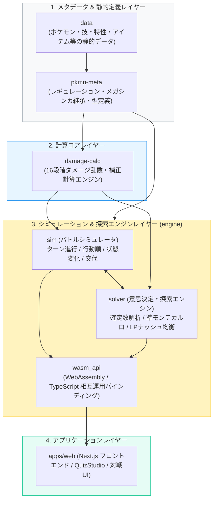
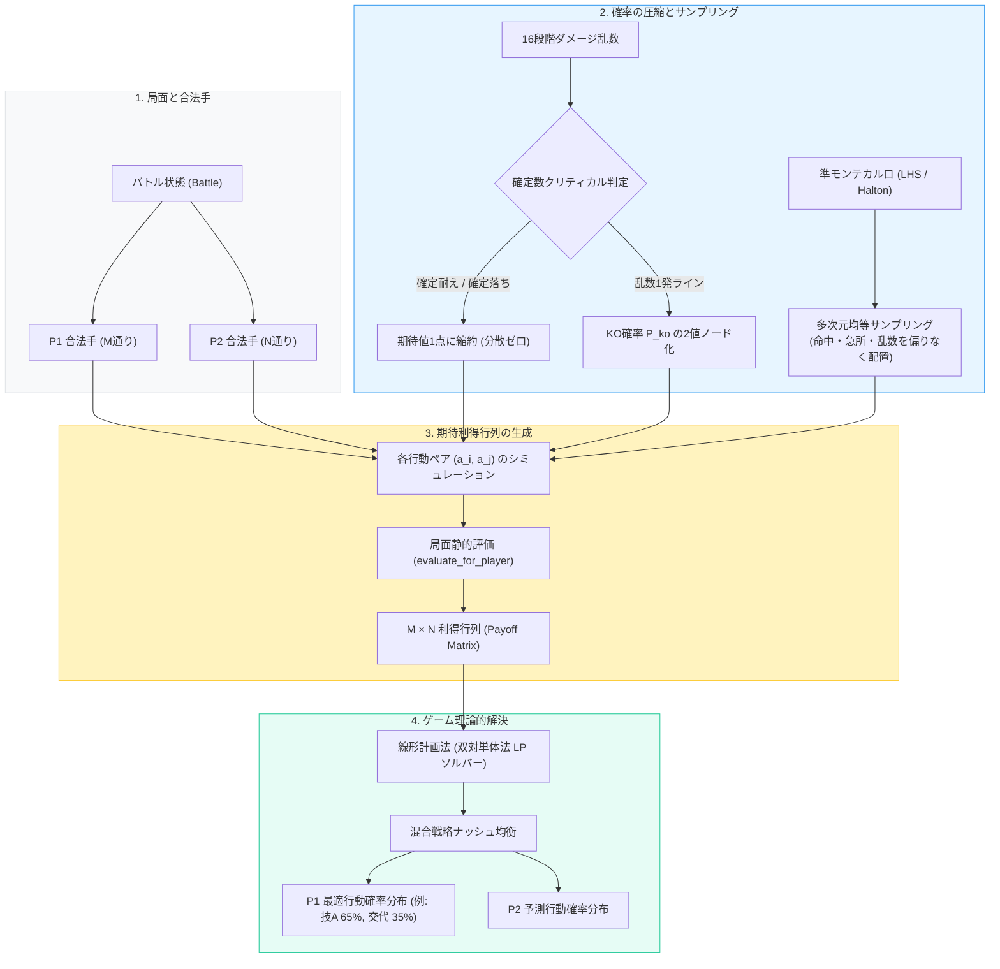
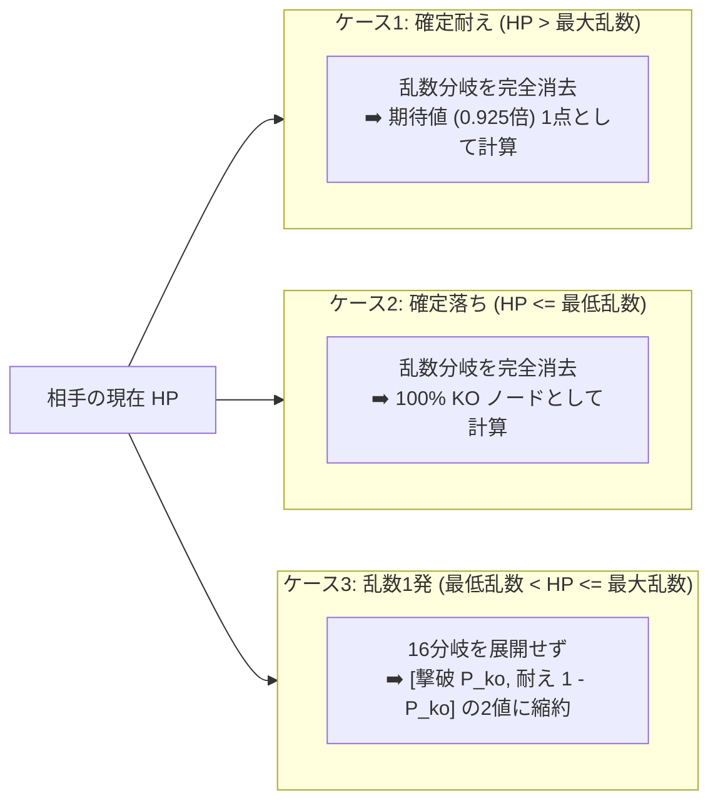

# @poketistix パッケージ群（Core Engines）アーキテクチャ解説書

本ディレクトリ（`packages/`）は、**『Pokémon Champions』**（メガシンカ等の過去要素を含むVGCダブルバトル環境）の対戦シミュレーション、ダメージ計算、メタデータ検証、およびゲーム理論的探索エンジンを提供する Rust / WebAssembly コアパッケージ群です。

---

## 1. パッケージ全体構成とデータフロー

`packages/` 内の各クレートは明確な責務境界を持ち、下位の純粋計算レイヤーから上位のシミュレーション・探索レイヤーへと一方向に依存しています。



---

## 2. 各パッケージの役割

### ① `data` (`packages/data`)
* **責務**: Pokémon Champions の全マスターデータ（ポケモン、技、特性、アイテム）の管理。
* **特徴**: JSON 定義と TypeScript / Rust 型定義を同期。多言語対応（日/英）データも含みます。

### ② `pkmn-meta` (`packages/pkmn-meta`)
* **責務**: レギュレーションルールの管理とドメイン定数定義。
* **特徴**:
  * Champions レギュレーション（禁止ポケモンの除外、技の追加・削除ルール）の検証。
  * メガシンカの継承関係（種族値・特性・タイプ変化）のメタデータ管理。

### ③ `damage-calc` (`packages/damage-calc`)
* **責務**: 16段階のダメージ乱数を含む確定ダメージ計算。
* **特徴**:
  * 威力補正、攻撃・特攻補正、防御・特防補正、天候、フィールド、急所、タイプ相性を網羅。
  * 入力 `DamageInput` に対し、`[u16; 16]` のダメージ配列、最低値（`min`）、最高値（`max`）を出力。

### ④ `engine` (`packages/engine`)
* **責務**: ダブルバトルの完全シミュレーションおよび最善手探索エンジン（Rust + Wasm）。
* **主要コンポーネント**:
  * **`sim`**: ターン進行、技実行、優先度・素早さ再計算、状態異常、まもる・交代の実装。
  * **`solver`**: 確率集約型 Expecti 探索、確定数解析、多次元準モンテカルロ法、ナッシュ均衡 LP ソルバー。
  * **`wasm_api`**: ブラウザや Node.js からミリ秒単位で呼び出せる WebAssembly API。

---

## 3. 探索エンジン (`engine::solver`) の詳細アーキテクチャ

ポケモン対戦は、ゲーム木探索において**最も過酷な2つの性質**を持っています：
1. **分散爆発（Variance Explosion）**: 命中（85%）、急所（1/24）、状態異常（10%〜30%）、乱数（16段階）、同速（50%）の幾重もの掛け算。通常のモンテカルロ法（ロールアウト）では試行回数が数万回必要となり収束しない。
2. **同時手番（Simultaneous Moves）**: 交互手番の Minimax を適用すると「相手に全て読まれる」前提の最悪手（Maximin）に縮退してしまう。

`solver` は、**「解析的な確率集約」＋「準モンテカルロ法（低不一致列）」＋「線形計画法（LP）によるナッシュ均衡」** の3段パイプラインで解決します。

### 全体パイプラインフロー



---

### コアアルゴリズム

#### A. ダメージ乱数の代表値化（`damage_distribution.rs`）
対戦において乱数が意思決定に影響を与えるのは**「確定数が動く（倒せるか耐えるか）」の境界線のみ**です。



また、累積ダメージは離散畳み込み $P(D_1 + D_2) = P(D_1) * P(D_2)$ により $O(16^2)$ で瞬時に解析計算されます。

#### B. 準モンテカルロ法とラテン超方格サンプリング（`quasi_random.rs`）
少数サンプリング（$N = 16$）で探索する際、通常の擬似乱数（PRNG）だと局所的な偏り（連続外し、急所の偏り）で推定値が歪みます。

```text
【通常の擬似乱数 (PRNG)】           【ラテン超方格サンプラー (LHS)】
   命中                                命中
1.0 ┌───────────────┐               1.0 ┌───┬───┬───┬───┐
    │  ●   ●        │                   │   │   │   │ ● │
    │        ●      │                   ├───┼───┼───┼───┤
    │               │                   │   │ ● │   │   │
    │  ●            │                   ├───┼───┼───┼───┤
    │               │                   │ ● │   │   │   │
    │      ●        │                   ├───┼───┼───┼───┤
    │               │                   │   │   │ ● │   │
0.0 └───────────────┘               0.0 └───┴───┴───┴───┘
    0.0           1.0 ダメージ乱数       0.0           1.0 ダメージ乱数
    (クラスターや空白が発生)            (各行・各列に均等に1点ずつ直交配置)
```

* **Halton 列**: 素数基数の根数逆変換により多次元空間を均等に充填。
* **ラテン超方格法 (LHS)**: $N$ 個のサンプルで、16段階乱数インデックス（0〜15）と命中・急所空間が重複なく均等に散布されることを保証。収束速度 $O(1/N)$ を実現。

#### C. 同時手番 GTO (ナッシュ均衡) LP ソルバー（`gto_solver.rs`）
ダブルバトルの「まもる集中砲火択」や交代読みの利得行列（$M \times N$）から、**双対単体法（Primal/Dual Simplex LP）** でゼロサムゲームの GTO（Game Theory Optimal: 混合戦略ナッシュ均衡）を厳密に解きます。

$$\max_{p} \min_{q} p^T A q$$

Minimax のような後出し縮退を起こさず、「相手が最適に対応してきても期待利得を最大化する最適な混合比率」を出力します。詳細な数学的背景は [GTO 理論解説書](./engine/docs/GTO_THEORY.md) を参照してください。

---

## 4. `engine/src/solver` ディレクトリ構造

| ファイル | 役割・責務 |
| :--- | :--- |
| [`solver.rs`](./engine/src/solver.rs) | `solver` モジュールの公開ルート定義 |
| [`damage_distribution.rs`](./engine/src/solver/damage_distribution.rs) | 16乱数の離散畳み込み、KO確率算出、確定数クリティカル代表値化 |
| [`quasi_random.rs`](./engine/src/solver/quasi_random.rs) | Halton列、ラテン超方格法（LHS）による低不一致サンプラー |
| [`gto_solver.rs`](./engine/src/solver/gto_solver.rs) | $M \times N$ 利得行列から GTO 最適解を解く単体法 LP ソルバー |
| [`expecti_engine.rs`](./engine/src/solver/expecti_engine.rs) | 合法手列挙、確率集約、LPナッシュ均衡を結合した探索実行器 |
| [`evaluator.rs`](./engine/src/solver/evaluator.rs) | 盤面の残HP、生存数、能力ランク等から静的勝率スコア [0.0, 1.0] を算出 |
| [`legal_actions.rs`](./engine/src/solver/legal_actions.rs) | ダブルバトルにおける全合法手（技、ターゲット、交代、メガシンカ）の列挙 |
| [`tests_competitive.rs`](./engine/src/solver/tests_competitive.rs) | まもる択・実ダメージ計算統合・QMC分散低減の Rust 実戦検証テスト |

---

## 5. テスト・検証コマンド

```bash
# 1. Rust ワークスペース全テスト
cargo test --workspace

# 2. 静的型チェック (Rust + TypeScript 全パッケージ)
pnpm check

# 3. Vitest シナリオテスト (engine パッケージ)
pnpm --filter @poketistix/engine run test

# 4. WebAssembly ビルド (Node.js & Bundler 向け)
pnpm --filter @poketistix/engine run build
```
